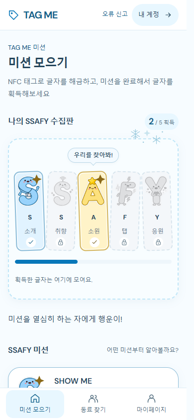
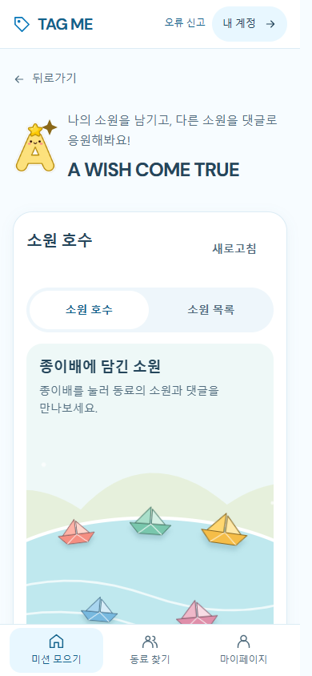
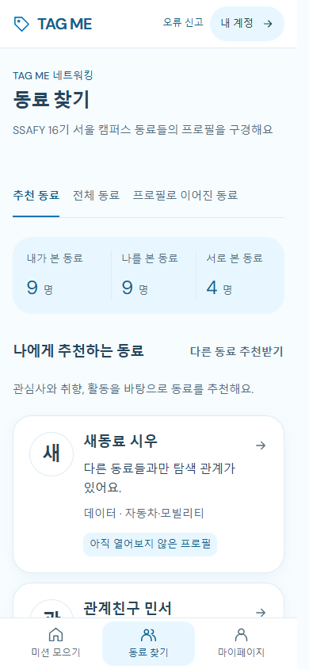
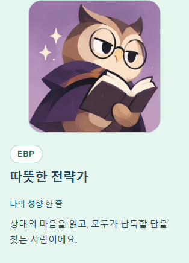
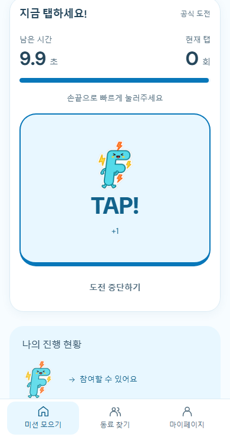
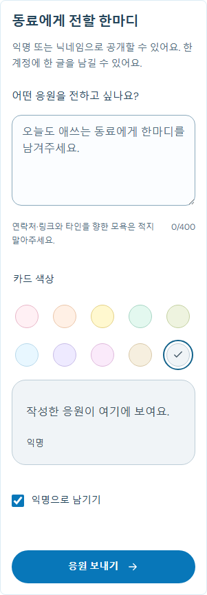
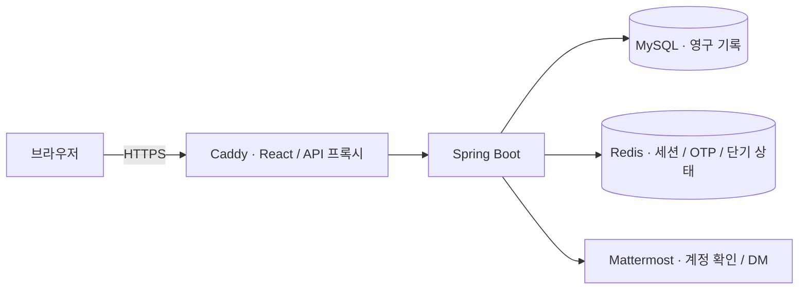

# TAG ME

SSAFY 16기 서울 캠퍼스를 위한 모바일 네트워킹 서비스입니다. 참가자는 현장의 NFC 태그로 미션을 열고, 다섯 글자 **SSAFY**를 모으며 서로의 프로필과 활동을 통해 대화를 시작합니다.

[운영 사이트](https://anonymity-developer.site) · [문서 안내](docs/README.md) · [로컬 실행](docs/development.md) · [서버·DB·Redis 이해하기](docs/infrastructure.md)

## 서비스 화면

아래 화면은 실제 참가자가 아닌 합성 데이터로 촬영했습니다. 첫 행은 로컬 fixture, 두 번째 행은 운영 빌드와 격리 API 대역을 사용한 화면입니다.

| 미션 수집판 | 종이배 소원 호수 | 동료 추천 |
| --- | --- | --- |
|  |  |  |

| SYNC 결과 | FAST TAP 플레이 | 응원 카드 작성 |
| --- | --- | --- |
|  |  |  |

## 핵심 흐름

1. Mattermost 아이디로 DM의 6자리 인증번호를 받아 확인하고, TAG ME 전용 비밀번호로 가입합니다.
2. 필수 프로필과 참여·공개 동의를 저장하면 행사 OPEN 중 첫 번째 `S`를 획득합니다.
3. 현장의 NFC 태그에서 해당 미션을 확인하고 열기를 눌러 나머지 네 미션에 참여합니다. 미로그인·프로필 미완료 상태면 인증/설정을 거쳐 태그로 돌아옵니다.
4. 미션 완료 시 글자를 받고, 수집판에서 진행 상황을 확인합니다.
5. 관심사·SYNC 유형·활동을 바탕으로 동료를 발견하고 프로필을 둘러봅니다. 추천·상세·방향 방문 그래프가 이어지며 별도 채팅 기능은 없습니다.

| 글자 | 미션 | 참가자가 하는 일 |
| --- | --- | --- |
| S | SHOW ME | 소개와 관심사를 담은 프로필 완성 |
| S | SYNC ME | 9개 질문에 답하고 취향 유형과 같은 유형의 동료 확인 |
| A | A WISH COME TRUE | 소원을 종이배로 띄우고 다른 소원에 댓글 남기기 |
| F | FAST TAP | 10초 공식 탭 기록에 도전하고 순위 확인 |
| Y | YOU GOT THIS | 모두에게 응원 메시지를 남기고 하트로 반응하기 |

## 구성

- Frontend: React 19, TypeScript, Vite, Caddy
- Backend: Java 21, Spring Boot 3.5, Spring Security/Session, Flyway
- Data: MySQL 8.4, Redis 7.4
- Runtime: Docker Compose, GitHub Actions, EC2

브라우저는 Caddy를 통해 React 앱과 `/api`를 사용합니다. Spring Boot가 인증·권한·미션 완료를 검증하고, MySQL이 영구 기록의 기준이며 Redis는 세션과 단기 인증 상태를 담당합니다. 자세한 경계는 [아키텍처](docs/architecture.md)에 정리되어 있습니다.



네 서비스는 단일 EC2의 서로 다른 컨테이너로 실행하고 DB/Redis 데이터는 볼륨에 저장합니다. GitHub Actions에서 검사·빌드한 릴리스를 EC2가 검증해 적용합니다. 관리자에게는 현황·순위·오류 신고·계정/글자 지원 조치와 실제 미션 UI의 격리 미리보기를 제공합니다.

## 로컬에서 확인하기

Docker Desktop과 Compose v2가 필요합니다. 실제 Mattermost나 운영 데이터를 사용하지 않는 fixture 환경입니다.

```powershell
Copy-Item .env.example .env.fixtures
# .env.fixtures에 로컬 전용 DB 비밀번호를 설정
docker compose --env-file .env.fixtures --project-name tagme-fixtures `
  -f compose.yml -f compose.dev.yml -f compose.fixtures.yml `
  --profile app up -d --build --wait
```

기본 접속 주소는 `http://localhost:8088`입니다. 테스트 계정, 로컬 태그, 초기화와 종료 방법은 [개발 가이드](docs/development.md#fixture로-전체-흐름-확인)를 따릅니다. `compose.fixtures.yml`은 `compose.prod.yml`과 함께 사용하면 안 됩니다.

## 문서

- [제품 개요](docs/overview.md) / [유저 플로우](docs/user-flows.md)
- [아키텍처](docs/architecture.md) / [데이터 모델](docs/data-model.md) / [ERD](docs/erd.md)
- [API 개요](docs/api.md)와 도메인별 OpenAPI
- [개발 가이드](docs/development.md) / [행사 운영](docs/operations.md) / [관리자 콘솔](docs/admin-console.md)
- [현재 구현 상태](docs/progress.md) / [Codex 셋업](docs/codex-setup.md)

운영 자격증명, 원본 NFC URL, `.env*`, DB 덤프와 실제 참가자 데이터는 저장소에 포함하지 않습니다.
