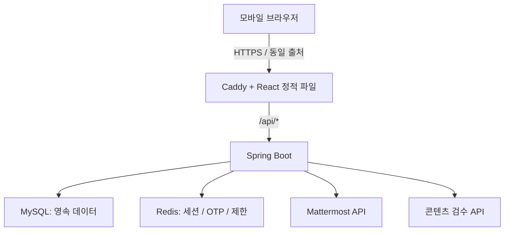

# 아키텍처

## 1. 구성

Java 21 + Spring Boot 3.5, React + TypeScript + Vite, MySQL 8.4, Redis 7.4를 사용한다. 백엔드는 도메인별 패키지를 가진 단일 애플리케이션으로 시작한다. 단일 VM의 Docker Compose에서 운영하며 실측 전에는 마이크로서비스로 분리하지 않는다.



외부 API 두 가지는 후속 연동 대상이다. 이번 초기 구성에는 실제 요청 코드나 사용자 인증 우회 경로를 넣지 않는다.

## 2. 책임 분리

| 구성 | 책임 | 데이터 기준 |
| --- | --- | --- |
| React | 입력, 미션 연출, 수집판, 동료 탐색, 그래프 | 서버 응답으로 상태 표시 |
| Caddy | 정적 파일, SPA fallback, API 프록시, 운영 HTTPS | `/api`를 SPA HTML로 응답하지 않음 |
| Spring Boot | 인증/인가, 검증, 완료 판정, 추천/집계 | 비즈니스 규칙의 실행 주체 |
| MySQL | 계정, 미션, 콘텐츠, 관계, 시상 및 이력 | 영속적 상태의 기준 |
| Redis | 세션, OTP, rate limit, 단기 캐시 | 만료 가능한 상태; 순위 기준 아님 |
| 검수 작업자 | DB 작업 조회, 외부 검수, 결과 반영 | 초기에는 같은 Boot 프로세스의 스케줄러 |

AI 호출 동안 DB 행 잠금이나 트랜잭션을 유지하지 않는다. 제출과 검수 작업 생성을 하나의 짧은 DB 트랜잭션으로 묶고, 작업자가 외부 호출 후 별도 트랜잭션으로 결과를 반영한다. 상세 설계는 구현 계획을 참고한다.

## 3. 실행 모드

- `compose.yml`: 공통 서비스, 내부 통신, 볼륨, 헬스체크. 기본 실행은 MySQL/Redis다.
- `compose.dev.yml`: 로컬 loopback 포트만 추가한다. `--profile app`으로 전체 스택을 실행할 수 있다.
- `compose.prod.yml`: Caddy 80/443만 외부 공개, 자동 HTTPS, Secure 세션 쿠키와 신뢰 프록시 설정을 적용한다.
- IDE 모드: DB/Redis만 Docker로 실행하고 Boot/Vite는 로컬에서 실행한다.

DB 준비 → API readiness → web 순으로 시작한다. 시작 의존성은 실행 중 자동 장애 복구를 보장하지 않으므로 런타임 장애도 모니터링한다. 운영에서 Actuator는 Caddy를 통해 공개하지 않는다.

## 4. 인증과 보안 경계

서버 세션 쿠키는 HttpOnly, SameSite=Lax이며 운영에서 Secure를 강제한다. Redis가 세션을 보관한다. 현재 API에는 폼 로그인과 HTTP Basic을 제공하지 않는다. OTP 구현 시 세션 고정 공격 방지를 위한 세션 ID 교체 및 SecurityContext 저장을 명시적으로 처리한다.

SPA는 `GET /api/v1/csrf`로 토큰을 받은 뒤 변경 요청의 `X-XSRF-TOKEN` 헤더에 넣는다. 로그인/로그아웃 후 토큰을 다시 받는다. CSRF를 전체 비활성화하지 않는다. 세션 쿠키와 달리 XSRF-TOKEN 쿠키는 CSRF 헤더 구성을 위해 JavaScript에서 읽을 수 있다.

프론트에서 보내는 사용자 ID, 관리자 역할, 완료 여부, 점수, 유형은 신뢰하지 않는다. 요청 사용자 ID는 세션에서 구한다. 링크는 HTTPS URL만 허용하고 텍스트는 HTML로 해석하지 않는다. 개인정보와 토큰은 로그 및 외부 검수 입력에서 제외한다.

사용자가 입력하는 인증번호는 숫자 6자리 일회용 문자열이다. 앞자리 0을 보존하며 발급 시마다 암호학적으로 안전하게 새로 생성한다. Redis에는 원문 대신 HMAC과 별도 challenge ID를 저장한다. 상세 발급/만료/시도 제한은 [구현 계획](implementation-plan.md)을 따른다.

### URL과 미션 권한

| 경계 | 규칙 |
| --- | --- |
| 메인 페이지 | 공개 진입 허용; 실제 참여 API는 서버 세션 필요 |
| NFC/QR 진입 | `/t/{token}`; 무작위 32바이트의 Base64URL 43자리 토큰을 사용하고 DB에는 SHA-256만 보관 |
| 태그 해금 | 인증 후 CSRF를 포함한 POST 요청으로 토큰/활성 상태/행사 기간을 확인하고 사용자별 해금 기록 저장 |
| 미션 수행 | 세션과 해당 사용자의 미션 해금 기록을 매 요청에서 확인; 직접 URL/API 접근도 동일하게 차단 |

API 경로의 복잡성을 접근 통제 수단으로 삼지 않는다. 토큰은 태그 링크의 추측을 막기 위한 값이며 계정 인증이나 현장 체류 증명을 대체하지 않는다. 메타/미션 목록에는 원문 태그 토큰을 반환하지 않는다. 태그 진입 페이지에는 `Referrer-Policy: no-referrer`를 적용하고 Caddy와 애플리케이션의 로그/분석에서 토큰 경로와 본문을 수집하지 않는다. 이 항목은 후속 구현 요구사항이며 현재 설정에 이미 적용됐다는 의미가 아니다.

## 5. 도메인 구성과 의존성

```text
backend/src/main/java/com/tagme/
  common/config, common/web    현재 구현: 보안, CSRF, 연결 확인
  auth/                       다음 단계: OTP, Mattermost, 세션
  user/                       프로필, 관심사, 공개 정책
  mission/                    태그 해금, 완료, 전체 수집
  wish/, cheer/               콘텐츠와 반응
  tap/, sync/                 공식 게임 및 성향 계산
  discovery/                  추천과 프로필 방문
  moderation/                 검수 작업, 버전, 관리자 판정
  admin/                      시상, 이벤트 설정, 감사 기록
```

미구현 패키지를 빈 파일로 채우지 않는다. 각 기능을 시작할 때 controller → application/service → repository/entity 순으로 책임을 나누고, 다른 도메인에 직접 HTTP controller를 호출하지 않는다. 완료 처리는 `MissionCompletionService`로 모은다.

프론트는 초기 `App`과 API client만 있다. 기능 개발 시 `pages`, `features/{auth,profile,collection,wish,cheer,tap,sync,discovery}`, `components`, `api`, `styles`로 확장한다. 라우팅/서버 상태 라이브러리는 해당 단계에서 추가하고 lockfile로 버전을 관리한다.

## 6. 배포와 확장

현재 CI는 검증만 수행한다. 실제 서버, 도메인, 이미지 레지스트리, 배포 자격증명은 아직 연결하지 않는다. 후속 배포는 테스트 → 커밋 SHA 이미지 빌드/푸시 → 백업/마이그레이션 → Compose 갱신 → readiness 및 API 확인으로 구성한다. 운영 행사 중 배포는 최소화한다.

확장은 수치로 판단한다. API p95, 오류율, DB 잠금 대기, 커넥션 풀, CPU/메모리, Redis 사용량, 검수 대기 시간을 측정하고 필요한 곳부터 조정한다. API 다중화 시에도 Redis 세션과 MySQL 제약을 유지하며 검수 작업의 claim/lease 처리를 먼저 검증한다.

## 참고 문서

- [Spring Boot Gradle plugin](https://docs.spring.io/spring-boot/3.5/gradle-plugin/getting-started.html)
- [Vite guide](https://vite.dev/guide/)
- [Compose 시작 순서](https://docs.docker.com/compose/how-tos/startup-order/)
