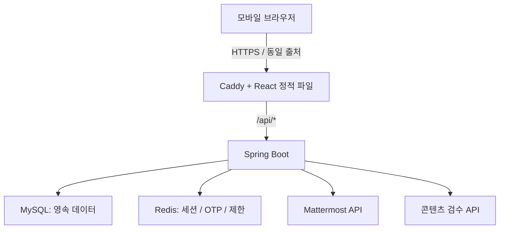
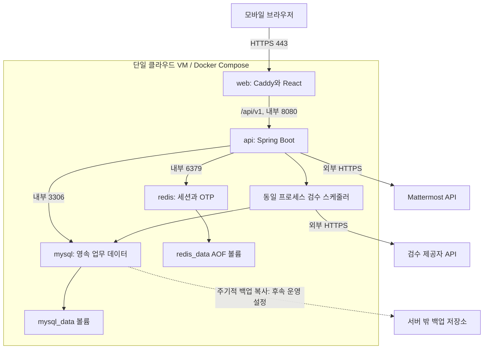
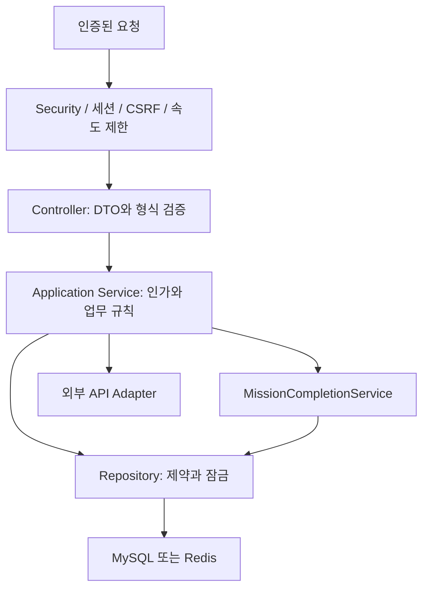
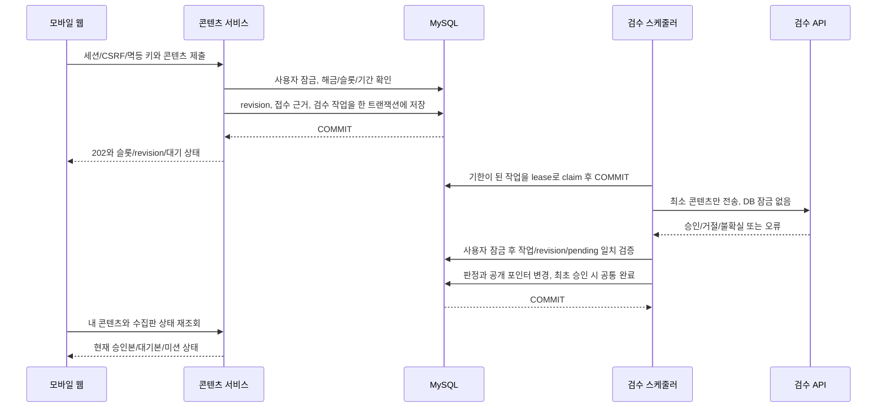
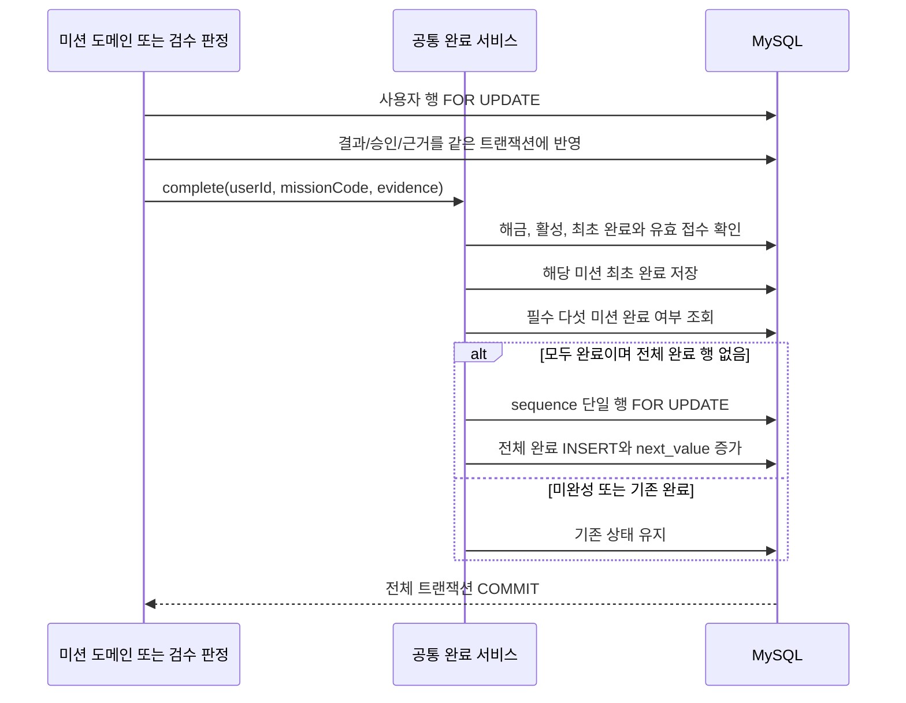
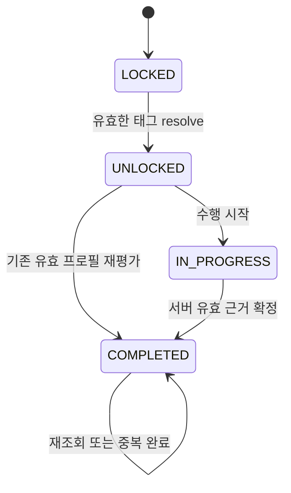
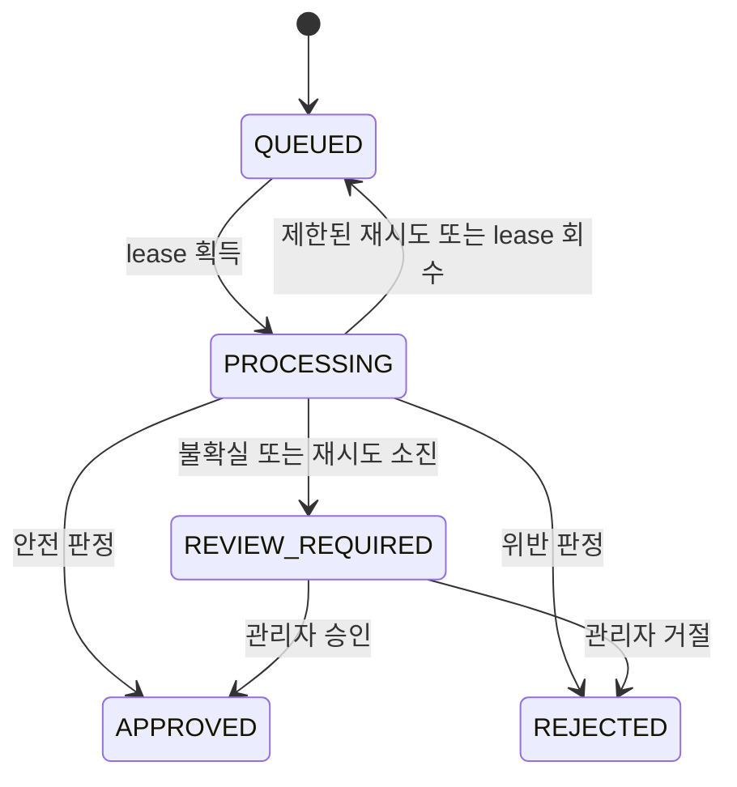
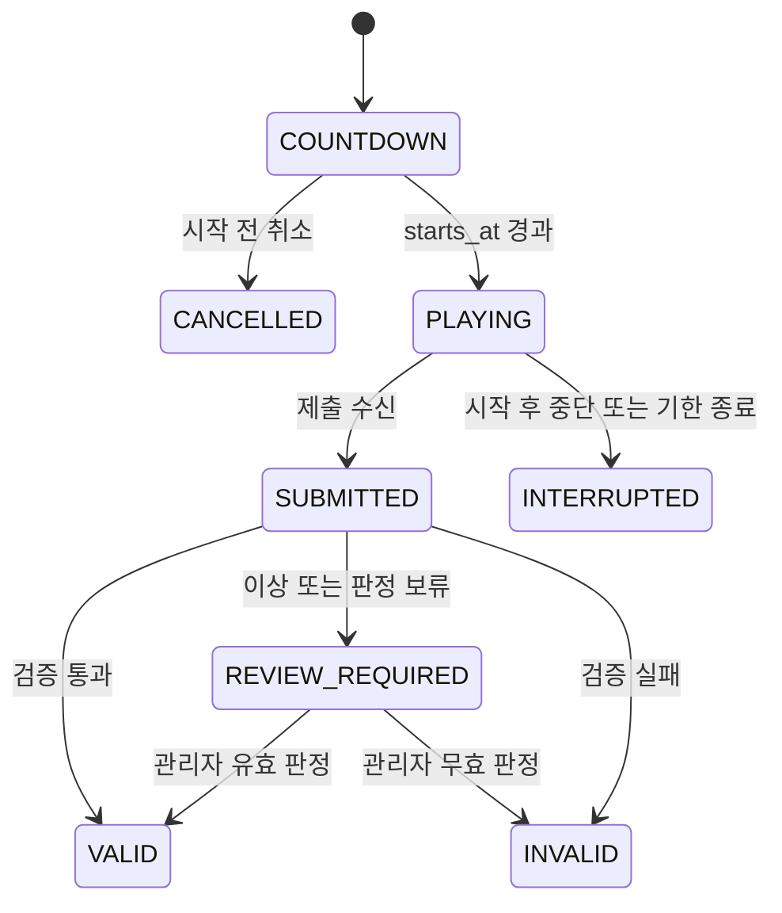

# 아키텍처

## 1. 구성

Java 21 + Spring Boot 3.5, React + TypeScript + Vite, MySQL 8.4, Redis 7.4를 사용한다. 백엔드는 도메인별 패키지를 가진 단일 애플리케이션으로 시작한다. 단일 VM의 Docker Compose에서 운영하며 실측 전에는 마이크로서비스로 분리하지 않는다.



외부 API 두 가지는 후속 연동 대상이다. 이번 초기 구성에는 실제 요청 코드나 사용자 인증 우회 경로를 넣지 않는다.

## 2. 책임 분리

| 구성 | 책임 | 데이터 기준 |
| --- | --- | --- |
| React | 입력, 미션 연출, 수집판, 동료 탐색, 그래프 | 서버 응답으로 상태 표시 |
| Caddy | 정적 파일, SPA fallback, API 프록시, 운영 HTTPS | `/api`를 SPA HTML로 응답하지 않음 |
| Spring Boot | 인증/인가, 검증, 완료 판정, 추천/집계 | 비즈니스 규칙의 실행 주체 |
| MySQL | 계정, 미션, 콘텐츠, 관계, 시상 및 이력 | 영속적 상태의 기준 |
| Redis | 세션, OTP, rate limit, 단기 캐시 | 만료 가능한 상태; 순위 기준 아님 |
| 검수 작업자 | DB 작업 조회, 외부 검수, 결과 반영 | 초기에는 같은 Boot 프로세스의 스케줄러 |

AI 호출 동안 DB 행 잠금이나 트랜잭션을 유지하지 않는다. 제출과 검수 작업 생성을 하나의 짧은 DB 트랜잭션으로 묶고, 작업자가 외부 호출 후 별도 트랜잭션으로 결과를 반영한다. 상세 설계는 구현 계획을 참고한다.

## 3. 실행 모드

- `compose.yml`: 공통 서비스, 내부 통신, 볼륨, 헬스체크. 기본 실행은 MySQL/Redis다.
- `compose.dev.yml`: 로컬 loopback 포트만 추가한다. `--profile app`으로 전체 스택을 실행할 수 있다.
- `compose.prod.yml`: Caddy 80/443만 외부 공개, 자동 HTTPS, Secure 세션 쿠키와 신뢰 프록시 설정을 적용한다.
- IDE 모드: DB/Redis만 Docker로 실행하고 Boot/Vite는 로컬에서 실행한다.

DB 준비 → API readiness → web 순으로 시작한다. 시작 의존성은 실행 중 자동 장애 복구를 보장하지 않으므로 런타임 장애도 모니터링한다. 운영에서 Actuator는 Caddy를 통해 공개하지 않는다.

## 4. 인증과 보안 경계

서버 세션 쿠키는 HttpOnly, SameSite=Lax이며 운영에서 Secure를 강제한다. Redis가 세션을 보관한다. 현재 API에는 폼 로그인과 HTTP Basic을 제공하지 않는다. 후속 JSON 로그인은 Mattermost username + TAG ME 비밀번호를 사용하고 가입/비밀번호 변경/재설정에만 DM OTP를 요구한다. 가입/로그인 성공 시 세션 ID 교체와 SecurityContext 저장을 명시적으로 처리한다.

SPA는 `GET /api/v1/csrf`로 토큰을 받은 뒤 변경 요청의 `X-XSRF-TOKEN` 헤더에 넣는다. 로그인/로그아웃 후 토큰을 다시 받는다. CSRF를 전체 비활성화하지 않는다. 세션 쿠키와 달리 XSRF-TOKEN 쿠키는 CSRF 헤더 구성을 위해 JavaScript에서 읽을 수 있다.

프론트에서 보내는 사용자 ID, 관리자 역할, 완료 여부, 점수, 유형은 신뢰하지 않는다. 요청 사용자 ID는 세션에서 구한다. 링크는 HTTPS URL만 허용하고 텍스트는 HTML로 해석하지 않는다. 개인정보와 토큰은 로그 및 외부 검수 입력에서 제외한다.

사용자가 가입/비밀번호 변경/재설정에 입력하는 인증번호는 숫자 6자리 일회용 문자열이다. 앞자리 0을 보존하며 발급 시마다 암호학적으로 안전하게 새로 생성한다. Redis에는 원문 대신 HMAC과 별도 challenge ID, Mattermost 내부 ID, purpose, 만료/시도 제한을 저장한다. 비밀번호 해시는 후속 MySQL user_credentials에 저장하며 일반 로그인에서 PasswordEncoder로 검사한다. users.mattermost_id는 외부 연결 키, 후속 mattermost_username은 입력 아이디다. 상세 계약은 [인증 설계](auth.md)를 따른다.

비밀번호 변경/재설정은 password_hash와 credential_version을 같은 트랜잭션으로 갱신한다. 세션에 저장한 version을 보호 요청마다 현재 DB 버전과 비교해 이전 세션을 거절하고 Redis 세션도 삭제한다. 현재 세션을 포함해 다시 로그인하도록 한다. 비밀번호/해시를 Mattermost/검수 API/로그/공개 응답으로 보내지 않는다.

### URL과 미션 권한

| 경계 | 규칙 |
| --- | --- |
| 메인 페이지 | 공개 진입 허용; 실제 참여 API는 서버 세션 필요 |
| NFC/QR 진입 | `/t/{token}`; 무작위 32바이트의 Base64URL 43자리 토큰을 사용하고 DB에는 SHA-256만 보관 |
| 태그 해금 | 인증 후 CSRF를 포함한 POST 요청으로 토큰/활성 상태/행사 기간을 확인하고 사용자별 해금 기록 저장 |
| 미션 수행 | 세션과 해당 사용자의 미션 해금 기록을 매 요청에서 확인; 직접 URL/API 접근도 동일하게 차단 |

API 경로의 복잡성을 접근 통제 수단으로 삼지 않는다. 토큰은 태그 링크의 추측을 막기 위한 값이며 계정 인증이나 현장 체류 증명을 대체하지 않는다. 메타/미션 목록에는 원문 태그 토큰을 반환하지 않는다. 태그 진입 페이지에는 `Referrer-Policy: no-referrer`를 적용하고 Caddy와 애플리케이션의 로그/분석에서 토큰 경로와 본문을 수집하지 않는다. 이 항목은 후속 구현 요구사항이며 현재 설정에 이미 적용됐다는 의미가 아니다.

## 5. 도메인 구성과 의존성

```text
backend/src/main/java/com/tagme/
  common/config, common/web    현재 구현: 보안, CSRF, 연결 확인
  auth/                       다음 단계: 비밀번호 로그인, 목적별 DM OTP, Mattermost, 세션
  user/                       프로필, 관심사, 공개 정책
  mission/                    태그 해금, 완료, 전체 수집
  wish/, cheer/               콘텐츠와 반응
  tap/, sync/                 공식 게임 및 성향 계산
  discovery/                  추천과 프로필 방문
  moderation/                 검수 작업, 버전, 관리자 판정
  admin/                      시상, 이벤트 설정, 감사 기록
```

미구현 패키지를 빈 파일로 채우지 않는다. 각 기능을 시작할 때 controller → application/service → repository/entity 순으로 책임을 나누고, 다른 도메인에 직접 HTTP controller를 호출하지 않는다. 완료 처리는 `MissionCompletionService`로 모은다.

프론트는 초기 `App`과 API client만 있다. 기능 개발 시 `pages`, `features/{auth,profile,collection,wish,cheer,tap,sync,discovery}`, `components`, `api`, `styles`로 확장한다. 라우팅/서버 상태 라이브러리는 해당 단계에서 추가하고 lockfile로 버전을 관리한다.

## 6. 배포와 확장

현재 CI는 검증만 수행한다. 실제 서버, 도메인, 이미지 레지스트리, 배포 자격증명은 아직 연결하지 않는다. 후속 배포는 테스트 → 커밋 SHA 이미지 빌드/푸시 → 백업/마이그레이션 → Compose 갱신 → readiness 및 API 확인으로 구성한다. 운영 행사 중 배포는 최소화한다.

확장은 수치로 판단한다. API p95, 오류율, DB 잠금 대기, 커넥션 풀, CPU/메모리, Redis 사용량, 검수 대기 시간을 측정하고 필요한 곳부터 조정한다. API 다중화 시에도 Redis 세션과 MySQL 제약을 유지하며 검수 작업의 claim/lease 처리를 먼저 검증한다.

## 7. 운영 배치와 통신 경로

다음은 compose.prod.yml을 사용하는 목표 배치다. 실제 서버/DNS 연결과 외부 API 연동은 아직 필요하다. 논리적인 역할을 나눈 것이며 검수 작업자는 초기에는 별도 컨테이너가 아닌 Boot 프로세스 내부 스케줄러다.



| 구간 | 개발 환경 | 운영 환경 |
| --- | --- | --- |
| 웹 | loopback 8088 또는 Vite 5173 | Caddy 80/443, HTTPS 리다이렉트/인증서 |
| API | loopback 8080, Vite/Caddy 프록시 | 외부 포트 공개 없이 Caddy에서만 전달 |
| MySQL/Redis | loopback 3306/6379 | 내부 Docker 네트워크에서만 접근 |
| 헬스체크 | 컨테이너/로컬 readiness | Actuator 외부 차단, 운영 점검은 내부에서 |
| 비밀키 | 로컬 환경변수 또는 IDE 설정 | 서버 환경변수/운영 비밀 관리, 프론트에 미전달 |

compose의 expose는 방화벽 인증 수단이 아니다. 호스트의 실제 포트/보안그룹과 운영 override 적용 여부를 함께 확인한다. Caddy의 요청 로그를 켤 때도 태그 토큰 경로가 남지 않게 설계한다. 외부 호출은 timeout을 두고 작업 ID와 오류 코드로 관측한다.

## 8. 요청 처리와 도메인 의존성



| 도메인 | 입력/출력 책임 | 주요 의존성 |
| --- | --- | --- |
| auth | 아이디/비밀번호 로그인, 가입/변경/재설정 DM OTP, 계정 범위와 세션 | MattermostAdapter, Redis, users/user_credentials, PasswordEncoder |
| user | 프로필, 관심사, 공개 동의 | users/profiles/interests/consents |
| mission | 태그 resolve, 해금, 수집판, 전체 완료 | tags/progress/evidence/sequence |
| wish/cheer | 사용자 슬롯, revision 제출, 댓글/하트 | 콘텐츠/검수 작업, mission 완료 |
| moderation | claim/lease, 제공자 호출, revision 판정 | 검수 Adapter, content 포인터, 완료 서비스 |
| tap/sync | 1회 참여, 서버 점수/유형 계산 | 공식 슬롯/결과, 접수 근거, 완료 서비스 |
| discovery | 추천 후보/점수, 공개 필터, 방문 그래프 | 프로필/관심사/성향/유효 활동 |
| admin | 제한/판정/재도전/정산/확정 | 각 도메인 서비스와 감사 로그 |

도메인은 다른 도메인의 controller를 호출하지 않는다. 공개 프로필 DTO, 익명 콘텐츠 DTO, 관리자 DTO를 분리한다. 완료 서비스를 중심으로 같은 트랜잭션을 사용하되 외부 HTTP는 DB 잠금 밖에서 처리한다. 프론트는 응답의 공식 상태를 표시하고 점수/유형/승인/순위를 확정하지 않는다.

## 9. 콘텐츠 제출과 검수 시퀀스



작업 claim과 판정 반영은 서로 다른 짧은 트랜잭션이다. DB 저장이 성공했는데 프로세스가 중단돼도 작업이 남아 복구된다. 제공자 응답 후 반영 전에 중단되면 lease 만료 후 재처리하며 판정/완료 멱등성을 적용한다. 한 번의 외부 호출만 일어난다는 보장은 하지 않는다.

## 10. 공통 완료와 동시성 시퀀스



잠금 순서는 사용자 → 콘텐츠/미션/공식 슬롯 → 전역 완료 sequence다. 한 사용자의 서로 다른 미션이 동시에 끝나도 마지막 미션 판정이 누락되지 않게 한다. 여러 사용자는 각자 처리하며 최종 순번 발급 구간만 전역 직렬화한다. 롤백된 요청은 완료 순번을 소비하지 않는다. 접수 영수증 ID에는 AUTO_INCREMENT 공백이 있어도 허용하며 이를 무공백 순위로 해석하지 않는다.

프로필 방문처럼 두 사용자 행이 필요한 작업은 필요한 ID를 먼저 정해 오름차순으로 잠근 뒤 도메인 행을 처리한다. 공개 전환/숨김도 대상 사용자 행을 잠가 열람 확인과 충돌하지 않게 한다. 이미 본인 행을 잠근 뒤 낮은 ID의 대상 행을 추가로 잠그는 식의 역순 획득을 피한다.

## 11. 상태 모델

### 미션



LOCKED는 현재 스키마에서 행 없음이다. IN_PROGRESS는 사용자 진행 상태이며 콘텐츠 검수 상태 자체를 저장하지 않는다. 콘텐츠 거절은 미션을 완료시키지 않고 같은 슬롯의 수정으로 진행한다. 완료 이후 숨김/탈퇴는 공개/자격에서 별도로 처리한다.

### 검수 작업



공개 여부는 작업 status만 보고 결정하지 않고 content item의 visibility/approved pointer와 함께 판단한다. 새 revision은 새 작업으로 처리한다. 이미 승인한 버전을 임의로 REJECTED로 덮어쓰는 대신 검토 이력과 콘텐츠 숨김을 구분한다.

### 공식 탭 게임



준비/연습 화면은 공식 attempt 이전 UI 상태다. PLAYING은 서버 시각으로 계산하며 해당 순간 별도 요청이 없었다고 게임 시간이 멈추지 않는다. 전송 장애 후 유예 안에 같은 attempt의 유효한 종료 payload가 오면 중단 사유와 함께 판정할 수 있고 기회는 자동 복구하지 않는다. 재도전 승인은 새 attempt를 생성하므로 위 도전 상태를 초기화하는 전이가 아니다.

## 12. 추천과 방문 데이터의 경계

추천은 공개 가능한 사용자를 먼저 고른 뒤 공통 관심사 비율, 성향 유사도, 승인된 댓글/하트의 공통 활동을 정규화해 가중 합산한다. 가중치는 설정값이고 효과가 입증됐다고 단정하지 않는다. 공개 범위나 익명 작성자를 추론할 수 있는 추천 이유는 반환하지 않는다. 익명 활동은 초기 추천에서 제외하거나 식별이 불가능한 집계 신호로만 사용한다.

신규 계정에는 공통 관심사와 아직 방문하지 않은 동료를 중심으로 fallback한다. 페이지/노드 수 상한을 두고 목록/그래프/통계를 같은 공개 필터로 계산한다. 임베딩/Vector DB는 초기 범위가 아니며 데이터와 성과를 확인한 뒤 확장한다. 프로필 방문 저장과 상세 반환은 한 서비스에서 처리하며 프로필 비공개 전환과 같은 사용자 행 잠금 순서를 맞춘다.

## 13. 장애와 복구 경계

| 장애 | 유지해야 하는 것 | 처리 |
| --- | --- | --- |
| MySQL 실패 | 미완료 쓰기를 성공으로 응답하지 않음 | 트랜잭션 롤백, readiness/오류 관측, 재시도 가능한 안내 |
| Redis 실패 | MySQL의 미션/콘텐츠/시상 기록 | 인증/세션/제한 실패를 우회하지 않음, 복구 후 재인증 |
| Mattermost 실패 | 계정 소유/대상 범위 검증 | 고정 코드/가짜 로그인 없이 일시 장애 안내 |
| 검수 API 실패 | 승인 전 비공개, DB 작업 이력 | 제한 재시도와 관리자 검토 |
| API 재시작 | 커밋된 결과와 처리 대기 작업 | lease 회수와 멱등 재처리, 클라이언트 상태 재조회 |
| 응답 유실 | 사용자 슬롯/멱등 키의 기존 결과 | 재요청 시 같은 결과, 새로운 참여 생성 금지 |

DB 볼륨은 백업이 아니며 Redis AOF도 경품 업무 데이터의 기준이 아니다. 단일 VM 장애는 전체 서비스에 영향을 줄 수 있다. 목표 복구 시간/데이터 복구 범위와 부하 목표는 행사 조건을 정해 실제 측정과 복원 훈련으로 확인한다.

## 관련 설계

### 기술 선택의 이유와 초기 제외 범위

| 선택 | 역할과 판단 |
| --- | --- |
| React/TypeScript | 미션별 상호작용과 상태/입력/컴포넌트 공유, 모바일 웹으로 시작 |
| Spring Boot/Java 21 | 인증/인가, 서버 검증, 트랜잭션, 운영 API를 단일 애플리케이션에 구성 |
| MySQL/InnoDB | 사용자 슬롯/복합키/유일 제약, 행 잠금, 완료 순번과 영속 시상 근거 |
| Redis | 만료되는 세션/OTP/요청 제한, 재시작/다중 API 인스턴스의 세션 공유 |
| Flyway | 적용된 DDL 이력과 코드의 계약을 버전으로 관리 |
| Caddy | 같은 출처의 정적 웹/API 프록시와 운영 HTTPS, 외부 공개 지점 단순화 |
| Compose | 단일 VM에서 실행 환경/네트워크/볼륨을 재현하고 초기 운영 복잡도 제한 |
| DB 검수 작업자 | 외부 API를 비동기 처리하고 재시작 복구; 초기 별도 브로커 운영 없이 시작 |

초기 설계에는 Kubernetes, 별도 메시지 브로커, 검색 엔진, Vector DB, 실시간 소켓을 필수로 두지 않는다. 검수 상태는 활성 화면의 제한된 주기 조회로 시작하고 탭 비활성/완료/이탈 시 중지한다. 지연/요청량/DB 작업 경합을 측정한 뒤 필요한 부분을 확장한다. Docker 파일 존재와 실제 서비스 용량/가용성 검증은 구분한다.

- [유저 플로우](user-flows.md): 사용자 관점의 정상/예외 경로
- [전체 ERD](erd.md): 엔티티와 키/관계
- [구현 계획](implementation-plan.md): 트랜잭션/검수/정산 알고리즘과 검증
- [행사 운영](operations.md): 개장, 장애, 재도전, 마감과 발표

## 참고 문서

- [Spring Boot Gradle plugin](https://docs.spring.io/spring-boot/3.5/gradle-plugin/getting-started.html)
- [Vite guide](https://vite.dev/guide/)
- [Compose 시작 순서](https://docs.docker.com/compose/how-tos/startup-order/)
