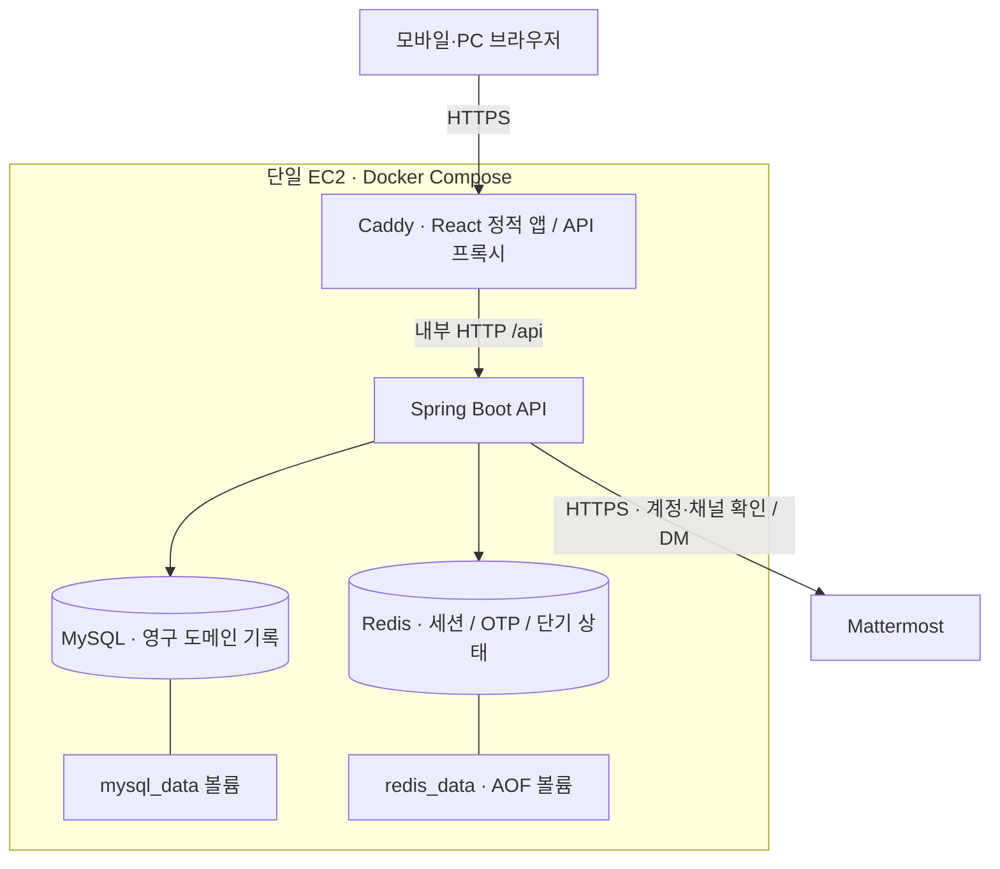

# 아키텍처

서버·컨테이너·DB·Redis 역할부터 이해하려면 [인프라 안내](infrastructure.md)를 먼저 읽는다.

## 실행 구성

- Caddy가 TLS, 정적 파일, `/api` 역방향 프록시를 담당한다.
- React SPA는 화면과 입력 상태를 관리하지만 인증·해금·완료 권한을 결정하지 않는다.
- Spring Boot는 세션, CSRF, 역할, 소유권, 행사 상태와 미션 근거를 검증한다.
- MySQL이 계정·프로필·미션·콘텐츠·관계·감사 기록의 기준이다. Flyway migration만 스키마를 변경한다.
- Redis는 Spring Session, OTP challenge·요청 제한, 15분 추천 노출 묶음 검증에 사용한다. 추천 결과 전체나 콘텐츠/하트 목록을 공용 캐시하는 구조는 아니다.
- 프론트/Caddy 이미지와 API 이미지는 별도이며 MySQL·Redis도 각각의 컨테이너다. DB는 인메모리가 아니고 named volume에 남는다. 컨테이너 재생성과 볼륨 삭제는 다르며, 단일 호스트/디스크 장애는 네 서비스에 영향을 준다. 외부 백업과 복원 검증은 별도 필요하다.

## 백엔드 모듈

| 패키지 | 책임 |
| --- | --- |
| `auth` | 참가자/관리자 로그인, DM OTP, 세션·자격증명 버전 |
| `profile` | Mattermost 정보와 TAG ME 프로필 |
| `participation` | 행사 상태, 동의, NFC 해금, 수집판과 완료 |
| `results` | SYNC 결과, FAST TAP 시도·순위 |
| `content` | 소원·응원, 댓글·하트, 직접 공개/수정과 선택적 검수 작업자 |
| `discovery` | 추천·검색·상세 공개·방향 방문 관계 |
| `operations` | 관리자 조회·지원 조치·감사·시상/결과 |
| `common` | 오류 형식, 보안·시간 등 공통 기반 |

프론트는 `pages`가 라우트 단위 조합을, `features`가 도메인 API와 상태를, `components`가 공통 UI를 담당한다. 관리자 미리보기는 실제 미션 컴포넌트에 격리 메모리 클라이언트를 연결하며 실제 DB 결과·검수·순위를 재현하는 통합 테스트는 아니다. 외부 라우터 없이 History API를 사용하는 동일 출처 SPA다.

## 핵심 처리 경계

### 인증

참가자 ID는 Mattermost username이지만 비밀번호는 TAG ME에서 별도로 설정한다. 가입·변경·재설정의 OTP는 계정과 목적에 묶고, 일반 로그인은 ID/비밀번호로 처리한다. 비밀번호는 사용자별 16바이트 salt와 PBKDF2-HMAC-SHA256 600,000회 해시로 저장하며 평문이나 복호화 가능한 비밀번호를 저장하지 않는다. 변경/재설정은 credential version을 올려 이전 세션을 차단한다. 관리자 ID는 충돌하지 않는 `admin:` namespace와 DB 역할을 사용한다.

### NFC와 미션 완료

NFC 원본은 32바이트 난수의 43자 Base64URL 값이며 DB에는 해시만 저장한다. 네 NFC 미션은 태그 검증 후 사용자별 해금 행을 갱신한다. 미션 완료는 사용자 잠금과 DB 제약을 공유하는 하나의 트랜잭션 경로를 사용해 중복 지급을 막는다.

### 콘텐츠와 공개

소원·응원·댓글은 기본 직접 공개다. 수정본, 현재 공개본, 미션 완료, 운영자 숨김과 시상 자격은 서로 다른 상태로 유지한다. 공개 DTO는 익명 작성자 연결과 내부 추천 신호를 제거한다.

### 운영 조치

관리자 쓰기는 현재 DB 역할을 다시 확인하고 CSRF·행 잠금·감사 기록을 같은 트랜잭션에서 처리한다. 게임 초기화는 이전 라운드를 보관하고 generation을 증가시켜 오래된 요청이 상태를 되살리지 못하게 한다.

## 배포

GitHub Actions가 프론트·백엔드·통합·이미지 검사를 수행하고 성공한 `main`의 공개 배포 릴리스를 만든다. Sydney EC2가 릴리스를 확인해 이미지를 실행하며 운영 환경은 SSM SecureString에서 받아 서버의 root 전용 환경 파일로 주입한다. 운영은 `compose.yml + compose.prod.yml + compose.small.yml + 릴리스 이미지 override`, 로컬 fixture는 별도 프로젝트·DB의 `compose.fixtures.yml`을 사용한다.

세부 배포와 복구는 [운영 배포](github-actions-ec2.md), 테이블 관계는 [데이터 모델](data-model.md)과 [ERD](erd.md)를 따른다.
