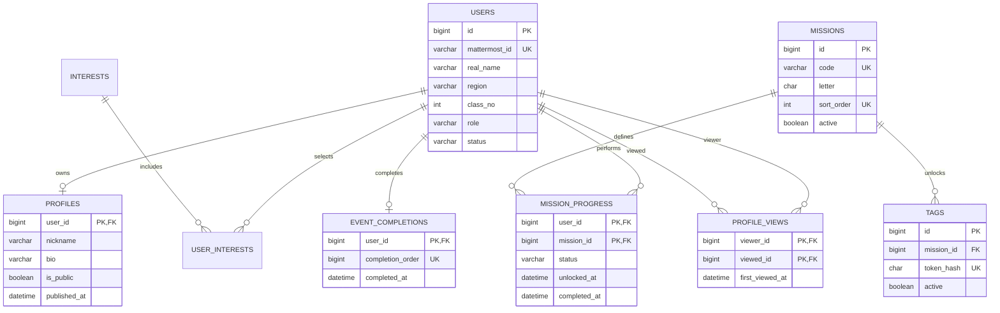

# 데이터 모델과 마이그레이션 계획

## 1. 적용 범위

현재 실행 가능한 DDL은 `backend/src/main/resources/db/migration`의 V1/V2/V3/V4/V5/V6/V7다. 소원/응원과 검수는 V6, 댓글/하트는 V7이며 시상은 아래 **후속 설계**다. 해당 도메인의 규칙과 함께 마이그레이션을 추가한다.

이 문서의 ERD는 핵심 요약이다. 모든 도메인의 컬럼/관계/복합키와 nullable 규칙은 [전체 도메인 ERD](erd.md)를 함께 읽는다. 현재 SQL과 후속 설계의 경계를 유지하고, 후속 설계를 현재 DB에 적용된 것으로 간주하지 않는다.

- MySQL 8.4 / InnoDB / utf8mb4
- 날짜는 UTC `DATETIME(6)`로 저장하고 UI에서 한국 시간으로 표시한다.
- 외부 계정 키와 서비스 사용자 키를 분리한다.
- 개인정보 삭제는 연결된 시상/운영 데이터 보관 정책까지 정한 뒤 명시적으로 구현한다. 무조건 cascade 삭제하지 않는다.
- 기획서의 단일 행사 운영을 기준으로 한다. 여러 행사 지원 시 event_id 및 복합 UNIQUE를 추가하는 별도 변경이 필요하다.

## 2. 현재 핵심 ERD

## 3. 현재 적용된 테이블

| 테이블 | 키 및 주요 제약 | 의미 |
| --- | --- | --- |
| users | PK id, UNIQUE mattermost_id, role/status CHECK | 인증된 참여자; ADMIN은 서버 운영 절차로만 부여 |
| user_credentials | PK/FK user_id, version > 0 CHECK | 해시와 갱신 시각, 세션 검증 버전 |
| profiles | PK/FK user_id | 사용자 1명에 프로필 최대 1개, 공개 기본값 false |
| interests | UNIQUE name | 관심사 사전 |
| user_interests | PK(user_id, interest_id) | 관심사 중복 방지 |
| missions | UNIQUE code, UNIQUE sort_order | 두 S를 구분하는 고정 미션 코드 |
| tags | UNIQUE token_hash | 원문 토큰을 저장하지 않음 |
| mission_progress | PK(user_id, mission_id), 상태/완료일 CHECK | 행 없음=LOCKED, 이후 UNLOCKED/IN_PROGRESS/COMPLETED |
| event_completion_sequence | PK id, id=1 CHECK | 전역 완료 순번 발급용 singleton |
| event_completions | PK user_id, UNIQUE completion_order | 전체 완성 최초 1회; 최종 시상 순위와 분리 |
| profile_views | PK(viewer_id, viewed_id), self-view CHECK | 최초 상세 방문, 역방향 조회용 인덱스 포함 |

프로필은 회원 생성 직후 없을 수 있어 관계가 0..1이다. 닉네임은 UNIQUE가 아니다. V4는 일반 관심사 카테고리를 시드한다. 실제 NFC 토큰/행사 날짜/동의 원문은 시드하지 않는다. V2에는 다섯 미션과 완료 sequence 초기값만 있다.

### 3.1. V3 아이디/비밀번호 스키마

일반 로그인은 Mattermost username + TAG ME 비밀번호다. V3가 다음 컬럼/테이블을 추가한다. V1/V2를 수정하거나 기존 사용자에 공용 비밀번호를 넣지 않는다.

| 변경 | 주요 컬럼/제약 |
| --- | --- |
| users 확장 | mattermost_username UNIQUE 추가. 실제 Mattermost에서 조회한 로그인 아이디, 기존 mattermost_id는 외부 계정 연결 키로 유지 |
| user_credentials 추가 | user_id PK/FK, password_hash VARCHAR(255), password_updated_at DATETIME(6), credential_version BIGINT. 사용자당 비밀번호 해시 하나 |

username은 정식 소문자 값, 최대 64자와 utf8mb4_0900_bin UNIQUE다. 기존 행은 실제 확인 전까지 NULL이다. 가입 전 프로필을 꾸며내지 않도록 real_name/region/class_no도 V3부터 NULL을 허용한다. 비밀번호는 PasswordEncoder 기반 적응형 단방향 해시만 보관하고 공개 DTO에 절대 포함하지 않는다. 변경/재설정은 hash/version을 한 트랜잭션에서 갱신하고 기존 세션을 전부 무효화한다. 기존 비밀번호 없는 계정은 본인 DM 인증 후 최초 비밀번호를 설정한다. [인증 설계](auth.md)와 [ERD의 V3 로그인 모델](erd.md)을 함께 따른다.

## 4. V6 소원/응원과 검수

실제 실행 DDL은 V6이며 [콘텐츠 계약](content.md)을 따른다. 별도 wishes/cheer_cards 테이블 대신 content_items에 kind별 1회 슬롯과 운 결과를 저장한다. 댓글과 하트는 아래 V7 구조로 추가했다.

| 테이블 | 실제 제약/역할 |
| --- | --- |
| content_items | id PK, author_id FK, kind WISH/CHEER, visibility_status, approved_revision_id/pending_revision_id, luck_score/landing_zone nullable, version; V7부터 UNIQUE(author_id,slot_kind) |
| content_revisions | id PK, item_id FK, revision_no, content_text, template_id, style, anonymous, submitted_at, moderation_status/reason_code, idempotency_key/payload_hash; UNIQUE(item_id,revision_no), UNIQUE(item_id,idempotency_key), UNIQUE(id,item_id) |
| moderation_jobs | id PK, revision_id UNIQUE FK, status, attempts/fence, next_run_at/lease_until, provider/policy_version/last_error_code |
| moderation_reviews | id PK, job_id FK, fence, reviewer_id nullable FK, decision/reason/created_at; UNIQUE(job_id,fence) |
| content_settings | id=1, wish_luck_min/max, wish_zone_count; 선택적 운영 설정이며 기본 행 없음 |

원본 생성 후 revision을 추가하고 approved/pending 복합 FK `(revision_id,item_id)`를 연결한다. FK는 같은 슬롯의 revision만 가리키게 한다. 본문/스타일/익명 여부는 revision 불변 값이며 검수 상태만 갱신한다. 현재 자동 작업은 revision당 1개이고 lease/fence/attempts로 재시도한다. 판정 이력은 fence별 여러 행이다. job/revision 생성과 원접수 receipt 저장은 같은 트랜잭션이다.

승인본과 대기본을 구분하고, 익명 JSON은 작성자/프로필/revision/접수 식별자를 반환하지 않는다. 댓글의 표시 설정과 하트 복합키는 V7에서 추가했다.

## 5. V5 게임/결과와 후속 시상

| 테이블 | 주요 컬럼/제약 |
| --- | --- |
| sync_results | V5 user_id PK/FK, questionnaire_version FK, answers_json, axis_scores_json, type_code, payload_hash, submitted_at |
| tap_slots | V5 user_id PK/FK, current_attempt_id, version; 공식 참여 권리 하나 |
| tap_attempts | V5 id PK, user_id FK, generation, idempotency_key, starts_at, ends_at, submit_deadline, status, tap_count, submitted_at, payload_hash; UNIQUE(user_id,generation), UNIQUE(user_id,idempotency_key), (id,user_id) 소유 FK |
| tap_attempt_events | V5 id PK, attempt_id FK, event_type(TAP/HIDDEN/PAGE_HIDE), relative_time_ms; 제출된 이벤트. 관리자 조치는 후속 |
| submission_receipts | id PK, user_id FK, source_kind, source_id, received_at; UNIQUE(user_id,source_kind,source_id), 최초 서버 접수 시각/순서. V4부터 구현; PROFILE/TAG_UNLOCK/SYNC_RESULT/GAME_ATTEMPT/WISH_REVISION/CHEER_REVISION 생성 |
| mission_completion_evidence | user_id/mission_id PK/FK, source_kind, source_id, accepted_received_at, receipt_order UNIQUE FK → submission_receipts.id; 최초 유효 근거 |
| award_runs | id PK, cutoff_at, finalized_at, rules_version, status, created_by; 정산 실행 snapshot |
| awards | id PK, award_run_id FK, award_type, user_id FK, rank, evidence_json, status; UNIQUE(run,type,rank) |
| content_reports | id PK, reporter_id FK, content_item_id FK, reason, status, resolved_by, resolved_at |
| event_settings | V4 singleton PK, opens_at, submit_closes_at, moderation_closes_at, game_duration, profile_preparation_enabled, settings_version |
| admin_audit_logs | id PK, actor_id, action, target_type/id, reason, before_json, after_json, created_at |
| activity_events | id PK, user_id nullable, event_name, target_id, occurred_at; 보관 기간/수집 범위 확정 후 추가 |
| user_consents | V4 id PK, user_id FK, policy_type, policy_version, agreed_at, withdrawn_at; 동의 증빙 |

`tap_attempts.user_id UNIQUE`를 사용하면 관리자 승인 재도전 이력을 보관할 수 없으므로 슬롯과 도전 기록을 나눈다. 정산 근거의 접수 순서는 서버에서 발급하고 클라이언트 시각을 사용하지 않는다.

submission_receipts는 제출을 받는 같은 트랜잭션에서 생성하며 승인 시 새로 만들지 않는다. 콘텐츠 source_id는 revision ID, 성향/게임은 결과 또는 attempt ID처럼 종류별로 유일한 원본을 참조한다. 여러 테이블을 가리키는 source_kind/source_id는 단일 FK로 보장할 수 없어 소스 존재/소유자/미션 일치를 서비스에서 검증한다. SHOW ME를 먼저 작성했다면 이후 태그 해금 접수가 유효 완료 근거가 된다. 상세 규칙은 ERD의 접수/시상 항목과 구현 계획을 따른다.

## 6. 쿼리 규칙

프로필 방문 관계는 `(viewer_id, viewed_id)` 정방향 PK와 `(viewed_id, viewer_id)` 인덱스를 사용한다. 상호 방문은 반대 행의 존재 여부로 계산한다. 사용자/프로필을 join하여 ACTIVE 및 공개 상태를 검사한다.

댓글 활동상은 승인된 revision과 공개/유효한 소원을 대상으로 `COUNT(DISTINCT wish_id)`를 집계하며 자신의 소원은 제외한다. 문자열 status 하나만 보지 않고 현재 공개 포인터와 운영 숨김 상태를 함께 확인한다.

대량 목록은 커서와 limit 상한을 사용한다. N+1 조회를 피하도록 DTO projection 또는 명시적 fetch 쿼리를 사용하며, 성능 개선은 EXPLAIN과 실제 데이터 측정 후 진행한다.

## 7. 마이그레이션 규칙

1. V1 핵심 스키마, V2 미션 시드는 이미 초기 구성에 포함한다.
2. V3는 인증 credentials, V4는 정책/동의/참여 근거를 추가했다. 이후 기능도 새 migration으로 추가한다.
3. 콘텐츠/revision/검수, 게임, 시상 순으로 해당 기능과 함께 추가한다.
4. 적용한 파일은 수정하지 않는다. 변경은 새 V 파일로 추가한다.
5. 데이터 삭제나 컬럼 제거 전에는 백업/복원과 애플리케이션 호환성을 확인한다. 애플리케이션 롤백만으로 DDL이 되돌아가지 않는다.

## V4 적용: 참여와 완료 근거

현재 적용 DDL에 event_settings, consent_policies, current_consent_policies, user_consents, user_consent_events, submission_receipts, mission_completion_evidence를 추가했고 profiles.version을 추가했다. 날짜/정책 원문/태그는 비워 두며 관심사 카테고리만 시드한다. 이름/반은 사용자 직접 입력이고 외부 검증 정보가 아니다.

정책 원문은 `(policy_type,policy_version)`별 보존하고 현재 포인터와 동의 이력을 분리한다. 철회는 과거 완료를 삭제하지 않는다. receipts는 `(user_id,source_kind,source_id)` UNIQUE이며 PROFILE source_id는 **사용자별 profile.version**이다. evidence의 복합 FK는 receipt의 소유자/종류/source_id까지 묶는다. accepted_received_at은 태그/유효 수행 조건을 만족한 시각의 최댓값이다. 구체 계약은 [참여 구현](participation.md), 다이어그램은 [ERD](erd.md)를 따른다.

## V5 적용: 최초 성향과 공식 탭

sync_questionnaires는 버전별 검토한 JSON을 보존하고 current_sync_questionnaire가 현재 버전을 가리킨다. 운영 문항은 시드하지 않는다. sync_results의 PK는 사용자이며 같은 정규화 답변 hash만 재시도한다. type/score는 서버가 계산한다.

tap_slots.current_attempt_id와 user_id 복합 FK가 다른 사용자의 도전을 가리키는 것을 막는다. 시작 key는 사용자 범위로 유일하고 준비 중 취소만 슬롯을 복구한다. events/최초 상태/payload_hash/receipt/글자를 한 트랜잭션에 쓴다. status의 COUNTDOWN은 저장된 진행 상태이며 PLAYING/AWAITING_SUBMISSION/기한 만료 표시는 시각으로 계산한다. 입력 원본과 결과의 외부 공개/관리자 재도전은 후속이다. 자세한 상태 전이는 [결과 계약](results.md)을 따른다.

## V7 댓글과 하트

| 실제 테이블/변경 | 제약과 관계 |
| --- | --- |
| content_items 확장 | kind=COMMENT 추가, slot_kind generated column과 UNIQUE(author_id,slot_kind)로 WISH/CHEER의 1회는 유지하고 COMMENT만 다중 허용. UNIQUE(id,kind) 및 INDEX(kind,id) 추가. 내 슬롯은 slot_kind 인덱스로 조회 |
| wish_comments | id PK, wish_id, content_item_id UNIQUE, author_id, idempotency_key/payload_hash. UNIQUE(author_id,key), wish/id 및 author/wish/id 인덱스 |
| 부모/작성자 FK | wish_id는 WISH, content_item_id는 COMMENT의 (id,kind) 복합 FK. item/author 복합 FK도 검사 |
| cheer_likes | (card_id,user_id) PK, created_at, CHEER 종류 복합 FK, 사용자 FK |
| submission_receipts | COMMENT_REVISION 허용. 본문/revision/job/bridge와 같은 트랜잭션에 접수 저장 |

댓글 revealProfile은 revision.anonymous의 반대 값으로 저장한다. 본인 전용 내역에만 requestKey/접수 시각을 주고 공개 댓글에는 ID/본문/표시 설정/허용된 닉네임만 반환한다. 댓글/하트는 최초 미션 완료 근거를 추가하거나 바꾸지 않는다. 상세 공개 조건과 승인 경합은 [반응 계약](reactions.md)을 따른다.
