# 전체 도메인 ERD와 관계 규칙

2026-11-13 응원 후속: `R__cheer_palette_and_feed_index.sql`은 revision의 기존 데이터/형태를 보존하면서 10색 CHECK와 `content_items(kind,visibility_status,archived_at,id)` 인덱스를 추가한다. 별도 카운터/캐시 테이블은 만들지 않는다. [현재 콘텐츠 계약](content.md).

2026-11-12 현재 계약: 한 줄 소개는 필수(200자 이내)이며 관심 산업 1~3개·개발 분야 1~3개를 선택한다. V16은 이름이 같은 기존 관심사 ID/선택을 유지하고 나머지를 LEGACY/비활성으로 보관한다. V17은 기술 스택 50개를 비활성화하고 기존 선택 행은 보존한다. 활성 선택지는 산업 10개·개발 분야 12개다. 목록·추천·그래프에 한 줄 소개와 분류 정보를 공개하고 이름·반·사진·외부 링크는 프로필 상세에서만 공개한다. 기존 사용자는 프로필을 보완한 후 동료 찾기를 이용하며 기존 글자·참여 기록은 삭제하지 않는다. [현재 추천·노출·공개 경계](recommendation-design.md). 아래 이전 필수/선택 규칙과 충돌하면 이 현재 계약을 따른다.

V16의 recommendation_exposures는 (viewer_id,batch_id,peer_id) PK, 양쪽 users FK와 shown_at을 가진다. (viewer,peer,shown_at) 조회 인덱스와 (viewer,shown_at) 정리 인덱스를 둔다. interests에는 active/group_name/display_order가 추가되고 INDUSTRY/DEVELOPMENT/TECH_STACK/LEGACY 분류를 사용한다.

V15의 추가 관계는 users 1:N error_reports(서버 신고자), users 1:0..1 account_deactivations(원래 외부 연결 보관), users 1:0..1 show_me_regrant_blocks(첫 S 재지급 차단)다. account_deactivations.change_id는 game_participation_resets.id를 참조하고, 조정 원장에 operation/mission_code가 추가된다. 비활성화한 user ID는 보존하며 재가입은 별도 ID라 이전 참여 FK와 합쳐지지 않는다. [현재 운영 지원 계약](support-and-member-controls.md).

V12는 `users 1 — N game_participation_resets`(user_id/actor_id FK), 콘텐츠/탭 archived_at과 현재 슬롯 UNIQUE를 추가한다. 초기화 전 결과는 보관하고 현재 참여와 순위에서 제외한다. [현재 공개·초기화 계약](direct-publication-and-reset.md).

V10에서 `users 1 — 0..1 local_admin_accounts`, `users 1 — N connection_sessions`가 추가됐다. local_admin_accounts는 user_id PK/FK·login_id UNIQUE, connection_sessions는 UUID PK·user_id FK·credential_version·started_at/last_seen_at/expires_at/ended_at·end_reason을 가진다. 상세 계약은 [관리자 콘솔](admin-console.md)이다.

이 문서는 읽기 편하게 도메인별로 나눈 전체 설계다. **1~3절의 기본 도식은 V1 테이블이며 1절의 소스 컬럼/관심사 분류는 V9 확장**이며, **1.1절 로그인 확장은 V3다. 8절의 접수/완료 근거와 9절의 동의/행사 설정 일부는 V4, 성향/게임은 V5, 승인 성향 문항 등록은 V18, 콘텐츠/검수는 V6, 댓글/하트는 V7, 관리자 감사/재처리 한도는 V8 절에 구현했다. 시상/신고와 나머지 활동은 후속 계획**이다. 후속 컬럼/타입은 migration 작성 시 검증하며, 존재하지 않는 FK나 테이블을 이미 적용한 것처럼 사용하지 않는다. 전체 테이블 사전과 인덱스 요약은 [데이터 모델](data-model.md)에 있다.

단일 행사 기준이며 다중 행사를 지원하려면 event_id와 UNIQUE 범위를 다시 설계해야 한다. 아래 대문자 엔티티는 실제 snake_case 테이블을 가리킨다. PK/FK/UK는 기본키/외래키/유일 제약이며 복합키는 설명에서 다시 명시한다.

## 1. 계정과 프로필 — 현재 DDL

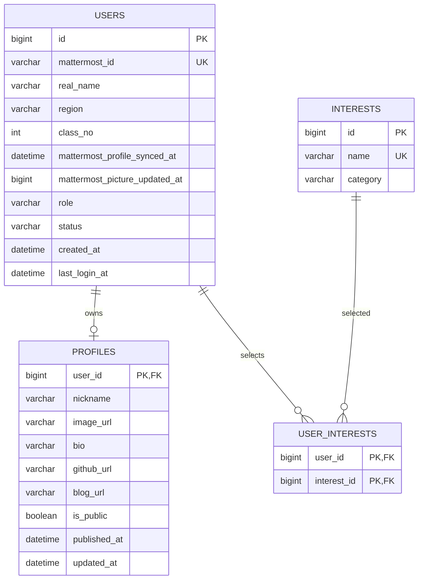

- users.mattermost_id가 외부 계정의 고유 키다. 표시 이름은 변경될 수 있으므로 식별자로 사용하지 않는다.
- USER/ADMIN 역할과 ACTIVE/SUSPENDED/WITHDRAWN 상태는 서버에서 관리한다. class_no는 V9부터 가입 인증 성공 때 파싱해 저장하며 기존 미동기화 행은 NULL일 수 있다.
- profiles의 user_id는 PK/FK이므로 사용자당 최대 1개다. DB 기본값 false는 레거시이며 현재 유효한 프로필 저장은 항상 true다. 닉네임 중복은 허용한다.
- user_interests는 `(user_id, interest_id)` 복합 PK다. 현재 FK는 삭제 cascade를 사용하지 않는다.
- 실명/반이 있는 users 엔티티를 그대로 목록 응답에 직렬화하지 않는다. 프로필 동의와 실제 공개 상태를 확인한다.

### 1.1. V3 로그인 아이디와 비밀번호 모델

다음 확장은 **V3에 구현했다**. 사용자 입력 아이디는 Mattermost username이고 비밀번호는 TAG ME 최초 가입 때 설정한다. 기존 mattermost_id는 외부 계정의 안정적인 연결 키로 유지한다.

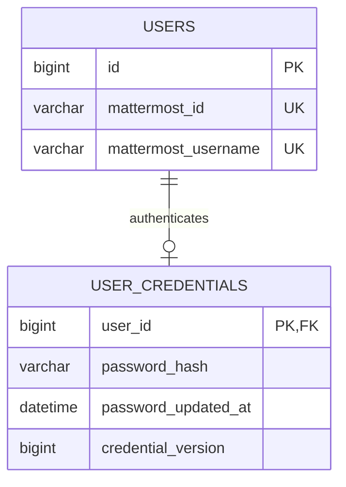

USER_CREDENTIALS는 신규 가입과 같은 트랜잭션에서 생성하고 해시가 없는 기존 계정은 DM 확인 후 최초 비밀번호 설정이 필요하다. password_hash만 보관하고 평문/복호화 가능 비밀번호는 저장하지 않는다. 변경/재설정 시 credential_version을 증가시켜 현재/다른 세션을 전부 무효화한다. username 갱신은 동일한 외부 내부 ID를 확인한 후에만 가능하며 계정 재사용/충돌을 자동 합병하지 않는다. 상세 목적별 OTP 계약은 [인증 설계](auth.md)를 따른다.

## 2. 미션, 태그와 전체 완료 — 현재 DDL

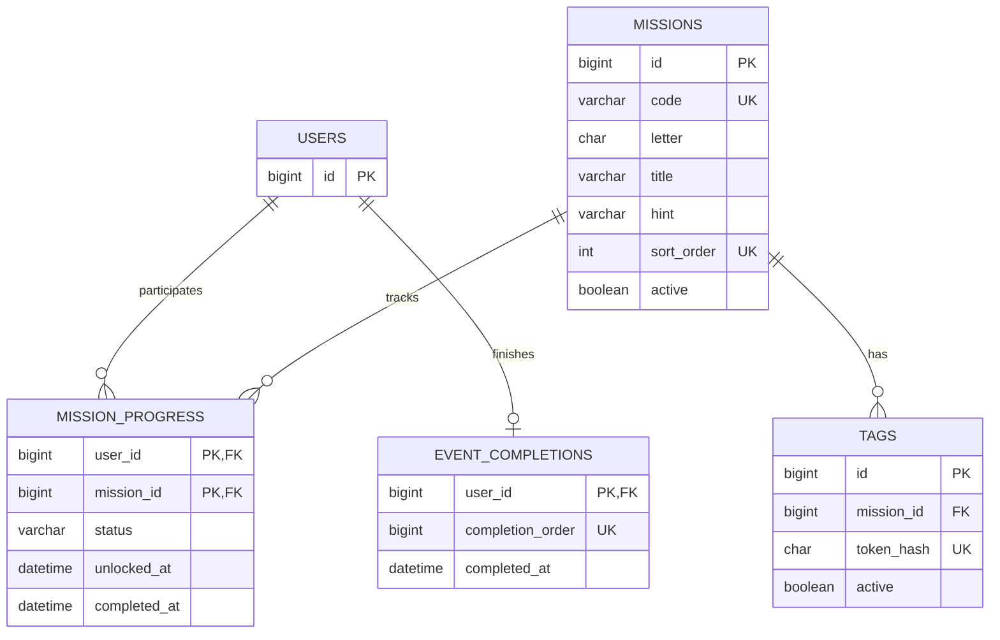

| 테이블 | 불변 조건 |
| --- | --- |
| missions | code와 sort_order는 각각 UNIQUE이며 S 글자는 중복된다 |
| tags | token_hash는 64문자 SHA-256 hex, ascii_bin. 한 미션에 여러 태그 연결 가능 |
| mission_progress | `(user_id,mission_id)` 복합 PK. 행 없음=LOCKED, 저장 상태는 UNLOCKED/IN_PROGRESS/COMPLETED |
| event_completions | user_id PK와 completion_order UNIQUE. 최초 전체 완료만 보관 |

`COMPLETED`일 때만 completed_at이 존재한다. 행이 해금됐다고 콘텐츠 검수까지 승인된 것은 아니다. 한 미션을 여러 태그로 열어도 진행 행은 하나다.

전역 순번 발급용 테이블도 V1에 존재한다. 특정 사용자나 완료 행에 직접 FK로 연결되는 관계가 아니므로 위 ERD에 임의의 관계선을 그리지 않는다.

| 테이블 | 컬럼 |
| --- | --- |
| event_completion_sequence | id TINYINT PK, next_value BIGINT |

이 테이블은 id=1인 단일 행, next_value>0 조건을 갖는다. V2에서 초기화하며, 사용자 완료 기록 생성과 같은 트랜잭션에서 해당 행을 잠그고 증가시킨다. 완료 순번은 시상 순위와 구별한다.

## 3. 방향 방문 관계 — 현재 DDL

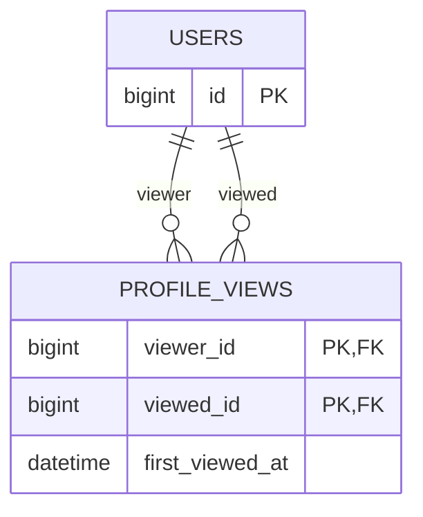

PK는 `(viewer_id, viewed_id)`, 역방향 탐색 인덱스는 `(viewed_id, viewer_id)`다. 자기 방문을 금지한다. A→B는 행 1개이고 B→A가 추가되면 상호 방문이다. 양방향 여부를 별도 컬럼에 중복 저장하지 않는다. 노출 시 현재 계정/프로필 상태와 현재 두 동의/필수 정보 완성을 다시 필터링한다. 페이즈 5-1에서 이 기존 V1 구조를 사용하며 migration 변경은 없다. first_viewed_at은 최초 DB UTC 시각이고 재열기로 갱신하지 않는다. 두 사용자 행을 ID 오름차순으로 잠근 뒤 최초 삽입해 중복/반대 방문과 계정 자격 변경을 직렬화한다. 자격을 잃어도 원장은 남지만 현재 그래프/통계에서 제외한다. 상세와 저장은 같은 트랜잭션이며 본인 간선/동료 간 전체 관계 공개는 없다. [탐색 계약](discovery.md)을 따른다.

## 4. 콘텐츠 원본과 검수 버전 — V6 구현

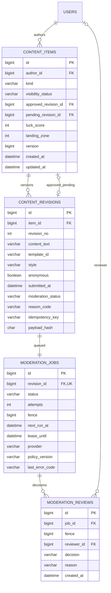

- 현재 kind는 WISH/CHEER다. UNIQUE(author_id,kind)가 각 1회 슬롯을 보장하고 운 결과는 소원 슬롯에만 저장한다. 별도 wishes/cheer_cards는 현재 생성하지 않는다.
- UNIQUE(item_id,revision_no)와 UNIQUE(item_id,idempotency_key), approved/pending 복합 FK `(revision_id,item_id)`를 적용한다. text/template/style/anonymous는 revision 생성 후 수정하지 않는다.
- revision당 작업은 하나이며 attempts/fence/lease로 회수/재시도한다. 오래된 fence 또는 다른 pending에 대한 결과는 반영하지 않는다.
- UNIQUE(job_id,fence)가 판정 이력 중복을 막는다. reviewer는 관리자면 사용자 ID, 자동이면 NULL이다.
- 별도 content_settings singleton은 운 범위/구역 수를 담고 기본 시드하지 않는다. 미설정 슬롯은 nullable 결과를 유지한다.
- 아래 댓글/하트/시상 구조는 후속 설계다. 기존 계획의 wishes/cheer_cards는 해당 기능을 구현할 때 V6 슬롯을 참조하는 방식으로 다시 확정한다. 현재 구현은 [콘텐츠 계약](content.md)과 V6 DDL이 기준이다.

## 5. 소원과 댓글 — 후속 설계

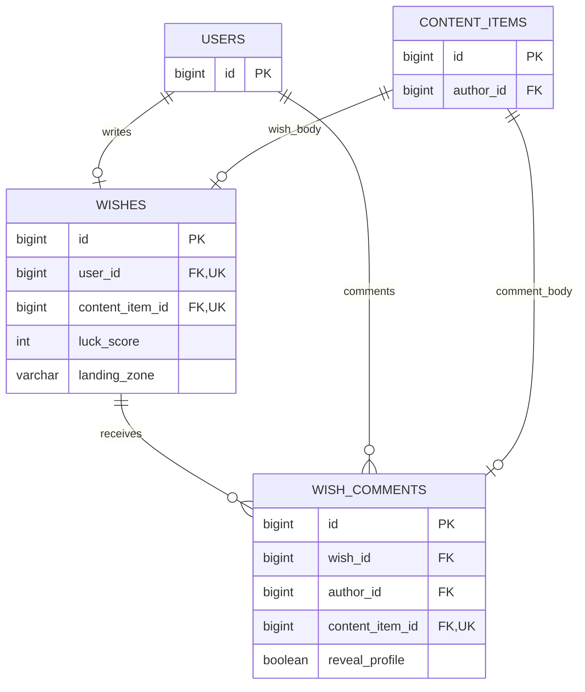

wishes.user_id UNIQUE가 1인 1슬롯을 보장한다. 소원 본문은 revision에 있고 운 점수/낙하 구역은 슬롯에 있어 수정해도 바뀌지 않는다. 댓글은 소원당 여러 개를 허용하지만 댓글 활동상은 타인의 유효한 소원에 남긴 승인 댓글의 `COUNT(DISTINCT wish_id)`다.

도메인 테이블의 작성자와 content_items.author_id가 항상 같은 사용자를 가리키게 검증한다. wishes에는 WISH item만, comments에는 COMMENT item만 연결한다. 공개/승인은 현재 포인터와 visibility로 판정한다. comments 인덱스는 `(wish_id,id)`, `(author_id,wish_id)`를 기본으로 한다.

## 6. 응원 카드와 하트 — 후속 설계

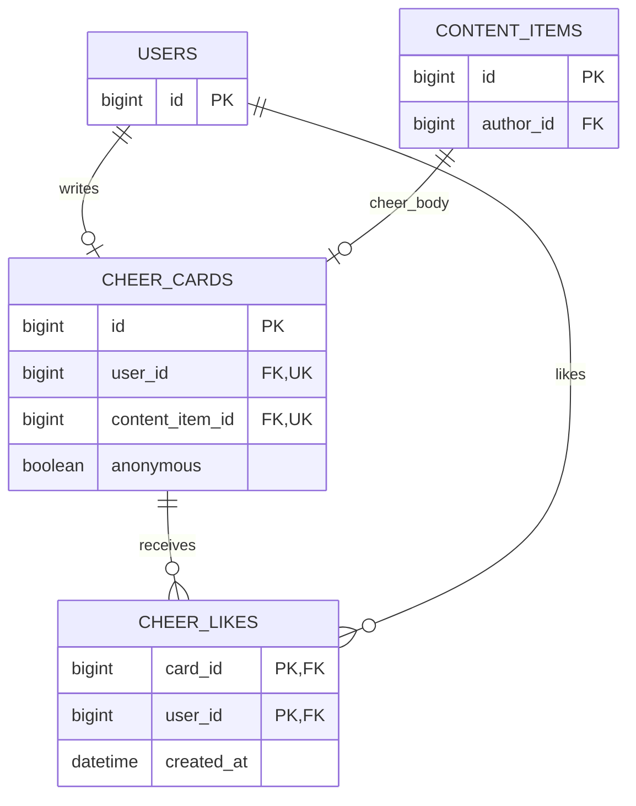

카드 슬롯은 사용자당 1개, 하트는 `(card_id,user_id)` 복합 PK다. 템플릿/허용 스타일은 presentation_json에 넣어 문구와 같은 버전으로 검수한다. 자신의 카드 하트는 서비스에서 거절한다. anonymous가 true인 공개 DTO에는 작성자 식별자를 넣지 않는다.

## 7. 성향과 공식 게임 — V5

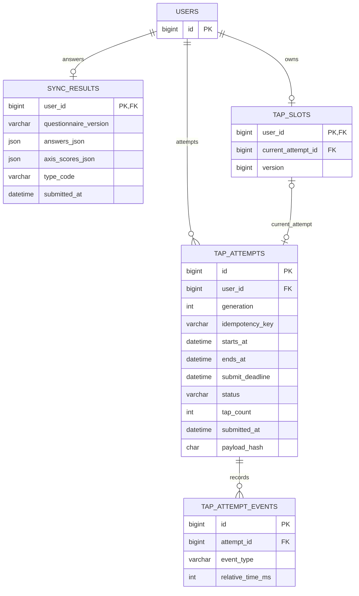

- sync_results.user_id PK로 최초 결과만 보관한다. V5의 sync_questionnaires 버전 FK와 payload_hash가 있고 current_sync_questionnaire가 현재 JSON을 가리킨다. 운영 문항은 시드하지 않는다.
- tap_slots는 공식 참여 권리, attempts는 도전 이력이다. `UNIQUE(user_id,generation)`으로 차수를 구분하고 관리자 승인 없이 새 공식 시도를 만들지 않는다.
- V5의 `(current_attempt_id,user_id)` FK는 `(tap_attempts.id,user_id)`를 가리킨다. 시작 key는 `(user_id,idempotency_key)` UNIQUE다. 슬롯과 attempt의 생성/포인터 갱신은 한 트랜잭션이며 순환 FK 생성 순서를 검증한다.
- 시작 전 취소는 CANCELLED, 시작 후 중단은 INTERRUPTED 등 이력으로 남긴다. 상세 전이는 [서버 처리 설계](architecture.md)의 게임 상태를 따른다.
- 서버 시작 시각/종료 시각/제출 유예가 기준이다. 이벤트 상대 시간은 검증 보조 데이터이며 브라우저 조작을 완전히 방지하지 못한다.

## 8. 접수 근거(V4)와 시상(후속)

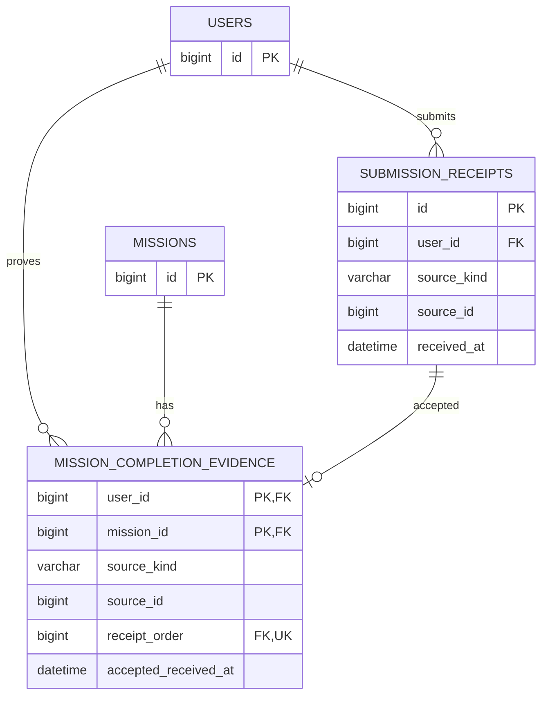

submission_receipts와 mission_completion_evidence는 V4에 구현했다. 현재 PROFILE/TAG_UNLOCK 접수를 저장하며, 콘텐츠 revision과 성향/게임 결과의 실제 생성은 후속이다. 동일 비즈니스 요청 재시도는 기존 영수증을 재사용하며 새 접수 순서를 얻지 않는다. 미션 근거는 유효한 최초 접수만 선택한다. receipt_order가 참조하는 ID와 시각을 승인 처리 시 새로 발급하지 않는다.

source_kind/source_id는 여러 도메인을 참조하는 식별자라 일반 FK 하나로 모든 대상 무결성을 보장할 수 없다. 유효한 소스 존재, 작성자/미션 일치, 승인 상태를 서비스에서 검증한다. 이미 저장된 receipt를 다른 사용자나 소스로 바꾸지 않는다. 같은 소스의 중복 접수 방지용 `UNIQUE(user_id,source_kind,source_id)`를 추가한다. 콘텐츠는 revision ID, 게임은 attempt ID, 프로필은 사용자별 profile.version을 source_id로 사용하며 TAG_UNLOCK은 mission ID로 구분한다. 사용자별로 키를 묶으므로 같은 미션을 여러 사람이 해금해도 충돌하지 않는다.

SHOW ME의 프로필을 태그보다 먼저 완성했다면 유효 완료 근거는 **두 조건이 모두 충족된 해금 접수**다. 그 외에도 해금 이전 행위를 수행 시간으로 인정하지 않는다. accepted_received_at은 해금/유효 수행 두 조건을 만족한 접수 시각이며, 검수 승인 시각과 다르다.

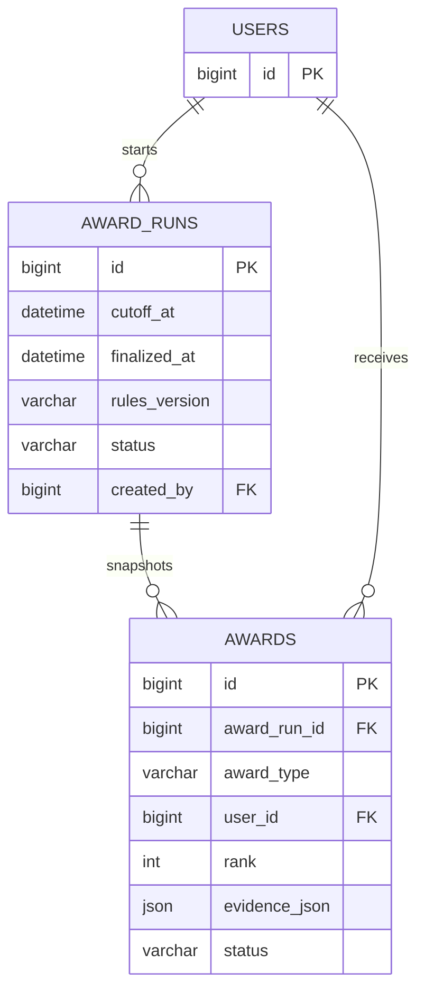

`UNIQUE(award_run_id,award_type,rank)`로 한 정산의 동일 수상 자리를 중복 배정하지 않는다. 재정산은 새 run으로 만들고 발표 이후 정정은 별도 이력을 남긴다. 초기 자동화는 후보 snapshot 생성이며 관리자 최종 확정과 구분한다. 경품 지급 연락처를 별도 수집한다면 목적/보관 기간을 정한 뒤 추가 설계하며 현재 ERD에 이미 있다고 가정하지 않는다.

## 9. 동의/설정(V4), 관리자 감사(V8)와 신고/활동(후속)

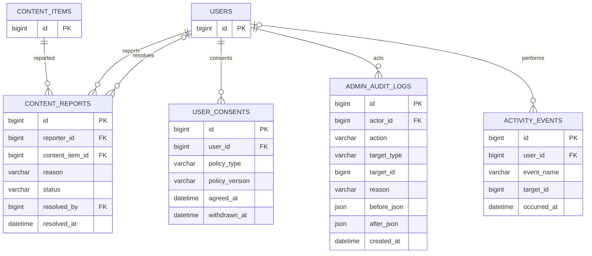

resolved_by는 처리한 관리자이며 미처리 신고에서는 NULL이다. V8 감사 로그 actor_id는 조치한 ADMIN 사용자의 실제 FK다. 자동 판정은 moderation_reviews에 남고 관리자 감사로 위장하지 않는다. content_reports와 activity_events는 아직 후속이다. before/after에는 비밀번호/토큰/불필요한 개인정보를 넣지 않는다. activity_events.user_id는 nullable이며 수집 목적/보관 기간을 확정한 이벤트만 넣는다.

| 테이블 | 컬럼 |
| --- | --- |
| event_settings | id TINYINT PK, opens_at DATETIME, submit_closes_at DATETIME, moderation_closes_at DATETIME, game_duration INT, settings_version BIGINT |

event_settings는 id=1인 단일 행사 설정이다. `opens_at < submit_closes_at <= moderation_closes_at`을 검증하고 game_duration은 양수이며 공식 기본값은 10초다. 카운트다운 5초와 제출 유예/OTP 제한 등 추가 운영 옵션의 컬럼 또는 설정 파일 위치는 migration/API 구현에서 확정한다.

## 10. FK와 인덱스 구현 점검

1. 핵심 10개 테이블은 V1 정의와 일치해야 한다. V2에는 미션과 순번 초기값만 넣고 실제 태그 토큰/개인정보를 시드하지 않는다.
2. 후속 테이블은 부모 → 자식 → nullable 순환 포인터 ALTER 순으로 추가한다. 참조 대상이 같은 사용자/item인지 별도로 검증한다.
3. 콘텐츠 목록 `(visibility_status,id)`, 검수 작업 `(status,next_run_at,id)`, 게임 순위 `(status,tap_count,id)`, 접수 `(user_id,received_at,id)`는 후보 인덱스다. 실제 쿼리/EXPLAIN을 확인하고 migration에 확정한다.
4. 중복 소원/카드/하트/방문/성향/완료는 UNIQUE/PK로 보장한다. UI 버튼 비활성화만으로 중복을 막지 않는다.
5. 완료/시상/감사 기록을 단순 cascade 삭제하지 않는다. 탈퇴/비식별화와 보존 기간은 행사 동의 정책을 따른다.
6. 원문 토큰, OTP와 세션 ID는 ERD의 영속 업무 데이터가 아니다. 세션/OTP/속도 제한은 Redis의 만료 상태로 관리하며 OTP에는 계정/purpose를 바인딩한다. 영속 비밀번호 해시는 V3의 user_credentials에만 보관한다.

## V4 정책 버전과 동의 이력

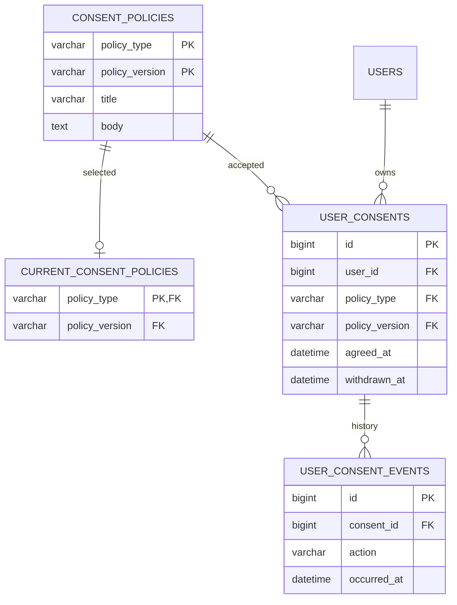

user_consents의 `(user_id,policy_type,policy_version)`은 UNIQUE이며 재동의/철회 사건은 append-only events에 남긴다. event_settings는 기존 계획 컬럼에 profile_preparation_enabled를 추가했고 기본 false다. profiles.version은 낙관적 충돌 검사와 PROFILE 접수 식별에 사용한다. 실제 제약은 수정하지 않은 V1~V3와 추가 V4 DDL이 기준이다.

V5의 실제 이벤트 행은 event_type/relative_time_ms이며 attempt에 payload_hash/review_reason을 둔다. 플레이 중 상태는 타임스탬프로 계산하며, 검토/순위/관리자 재도전은 후속이다. [결과 구현](results.md)이 현재 규칙이다.

## V7 실제 댓글/하트 관계

아래는 실행된 V7 구조다. 앞의 별도 wishes/cheer_cards 확장 도식은 초기 후속 설계였으며 현재는 통합 content_items의 종류별 ID를 사용한다.

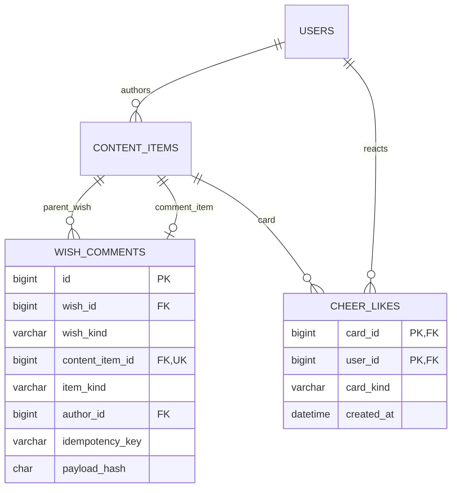

kind 상수 CHECK와 (id,kind) 복합 FK가 소원/카드/댓글의 혼용을 막는다. (comment_item,author) FK도 확인한다. content_items의 WISH/CHEER 슬롯은 generated slot_kind의 UNIQUE로 그대로 유지하고 COMMENT일 때만 NULL로 다중 작성을 허용한다. 본문/판정은 앞의 기존 revision/job/review 모델을 재사용한다.

## V8 실제 관리자 감사·재처리 구조

| 관계/테이블 | 실제 DDL |
| --- | --- |
| users 1 → N admin_audit_logs | actor_id NOT NULL FK. 관리자 조치의 수행 계정 |
| admin_audit_logs | id PK, action VARCHAR(32), target_type VARCHAR(24), target_id BIGINT, reason VARCHAR(300), before_json/after_json JSON, created_at DATETIME(6) |
| 감사 제약 | action은 MODERATION_DECISION/MODERATION_RETRY/CONTENT_VISIBILITY, 대상 종류 CONTENT/MODERATION_JOB, 대상 양수, 사유 공백 제외 1~300자 |
| 감사 인덱스 | (action,id), (target_type,target_id,id) |
| moderation_jobs | manual_retry_count INT DEFAULT 0, CHECK 0~3. (status,id) 인덱스 |
| content_items | (kind,visibility_status,id) 운영 조회 인덱스 |

감사의 target_type/target_id는 다형 대상 메타데이터이므로 특정 테이블 FK로 그리지 않는다. revision 원문·접수 근거·승인/대기 포인터와 완료 기록은 기존 V6/V7/V4를 유지한다. V8은 신고/시상/회원 제재 테이블이나 참가자 데이터를 만들지 않는다. 조치/감사 원자성과 보관 한계는 [운영 계약](operations-admin.md)을 따른다.

## V9 가져온 프로필과 분류 카탈로그

users의 real_name/region/class_no는 Mattermost에서 파싱한 원본 표시 정보다. mattermost_profile_synced_at은 가져오기 성공 시각, mattermost_picture_updated_at은 사진 버전(0은 사진 없음)이다. interests에 category DOMAIN/TECH_STACK가 추가되며 user_interests 관계는 그대로다. 이미지 원본은 저장하지 않는다. profiles.is_public은 내부 레거시 컬럼으로 남고 새 저장은 항상 true다. 사용자가 이름/반/비공개 여부를 입력하지 않는다. 관심사·소개·링크는 선택이다. [현재 프로필 계약](mattermost-profile.md)이 이전 직접 입력/공개 철회 설계를 대체한다.

## V13 기록 갱신 관계

`tap_attempts (id,user_id)` 1 → 0..1 `tap_record_achievements (attempt_id,user_id)`이며 복합 FK가 소유권을 보장한다. 소감은 갱신 권한 행의 nullable 필드로 한 번 저장하며 `(user_id,message_key)` UNIQUE를 갖는다. `tap_record_lock`은 id=1 단일 행이다. 참여 초기화 시 시도/갱신 권한은 삭제하지 않고 부모 시도를 보관한다. 콘텐츠 revision 본문은 300자로 확장한다. [DDL·규칙](mission-rules.md).
