# 전체 도메인 ERD와 관계 규칙

이 문서는 읽기 편하게 도메인별로 나눈 전체 설계다. **1~3절의 기본 도식은 V1에 존재하는 테이블**이며, **1.1절의 로그인 확장과 4~9절은 후속 migration으로 추가할 계획**이다. 후속 컬럼/타입은 migration 작성 시 검증하며, 존재하지 않는 FK나 테이블을 이미 적용한 것처럼 사용하지 않는다. 전체 테이블 사전과 인덱스 요약은 [데이터 모델](data-model.md)에 있다.

단일 행사 기준이며 다중 행사를 지원하려면 event_id와 UNIQUE 범위를 다시 설계해야 한다. 아래 대문자 엔티티는 실제 snake_case 테이블을 가리킨다. PK/FK/UK는 기본키/외래키/유일 제약이며 복합키는 설명에서 다시 명시한다.

## 1. 계정과 프로필 — 현재 DDL

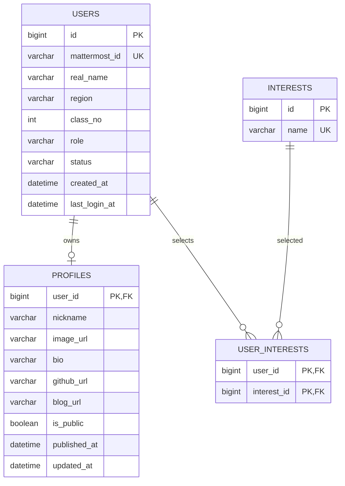

- users.mattermost_id가 외부 계정의 고유 키다. 표시 이름은 변경될 수 있으므로 식별자로 사용하지 않는다.
- USER/ADMIN 역할과 ACTIVE/SUSPENDED/WITHDRAWN 상태는 서버에서 관리한다. class_no는 양수다.
- profiles의 user_id는 PK/FK이므로 사용자당 최대 1개다. 초기 공개값은 false다. 닉네임 중복은 허용한다.
- user_interests는 `(user_id, interest_id)` 복합 PK다. 현재 FK는 삭제 cascade를 사용하지 않는다.
- 실명/반이 있는 users 엔티티를 그대로 목록 응답에 직렬화하지 않는다. 프로필 동의와 실제 공개 상태를 확인한다.

### 1.1. 후속 로그인 아이디와 비밀번호 모델

다음 확장은 **현재 V1에 없는 후속 설계**다. 사용자 입력 아이디는 Mattermost username이고 비밀번호는 TAG ME 최초 가입 때 설정한다. 기존 mattermost_id는 외부 계정의 안정적인 연결 키로 유지한다.

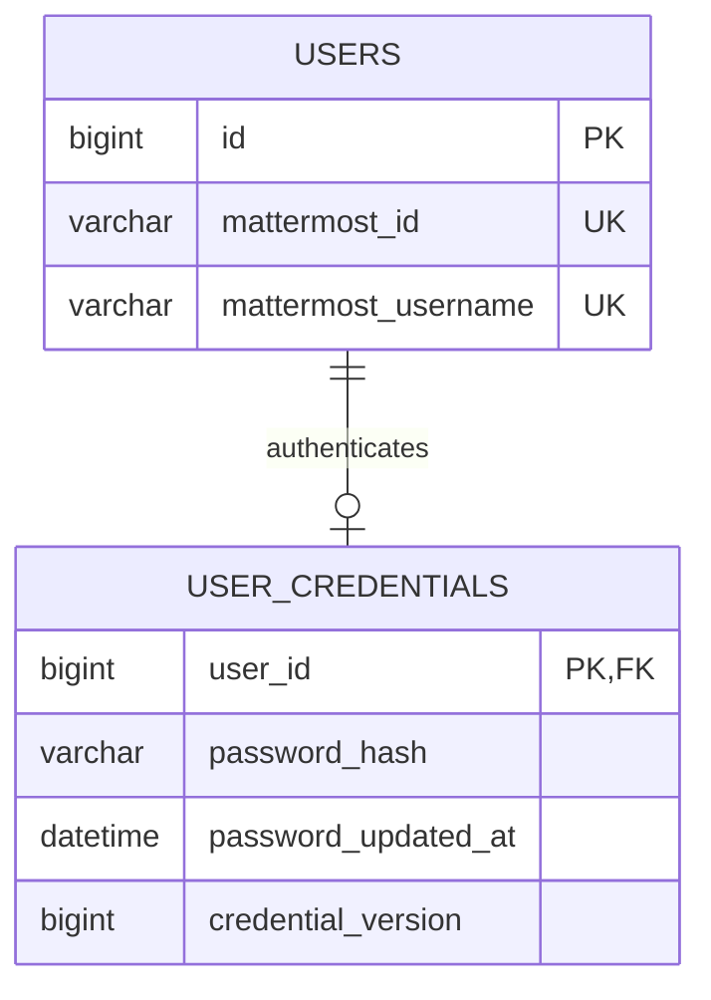

USER_CREDENTIALS는 신규 가입과 같은 트랜잭션에서 생성하고 해시가 없는 기존 계정은 DM 확인 후 최초 비밀번호 설정이 필요하다. password_hash만 보관하고 평문/복호화 가능 비밀번호는 저장하지 않는다. 변경/재설정 시 credential_version을 증가시켜 현재/다른 세션을 전부 무효화한다. username 갱신은 동일한 외부 내부 ID를 확인한 후에만 가능하며 계정 재사용/충돌을 자동 합병하지 않는다. 상세 목적별 OTP 계약은 [인증 설계](auth.md)를 따른다.

## 2. 미션, 태그와 전체 완료 — 현재 DDL

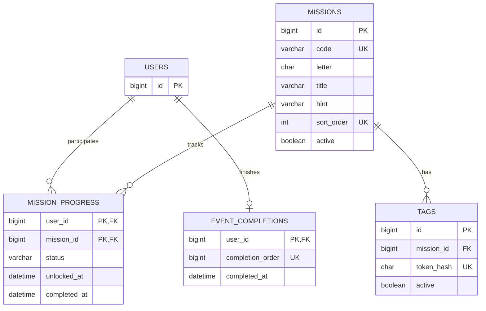

| 테이블 | 불변 조건 |
| --- | --- |
| missions | code와 sort_order는 각각 UNIQUE이며 S 글자는 중복된다 |
| tags | token_hash는 64문자 SHA-256 hex, ascii_bin. 한 미션에 여러 태그 연결 가능 |
| mission_progress | `(user_id,mission_id)` 복합 PK. 행 없음=LOCKED, 저장 상태는 UNLOCKED/IN_PROGRESS/COMPLETED |
| event_completions | user_id PK와 completion_order UNIQUE. 최초 전체 완료만 보관 |

`COMPLETED`일 때만 completed_at이 존재한다. 행이 해금됐다고 콘텐츠 검수까지 승인된 것은 아니다. 한 미션을 여러 태그로 열어도 진행 행은 하나다.

전역 순번 발급용 테이블도 V1에 존재한다. 특정 사용자나 완료 행에 직접 FK로 연결되는 관계가 아니므로 위 ERD에 임의의 관계선을 그리지 않는다.

| 테이블 | 컬럼 |
| --- | --- |
| event_completion_sequence | id TINYINT PK, next_value BIGINT |

이 테이블은 id=1인 단일 행, next_value>0 조건을 갖는다. V2에서 초기화하며, 사용자 완료 기록 생성과 같은 트랜잭션에서 해당 행을 잠그고 증가시킨다. 완료 순번은 시상 순위와 구별한다.

## 3. 방향 방문 관계 — 현재 DDL

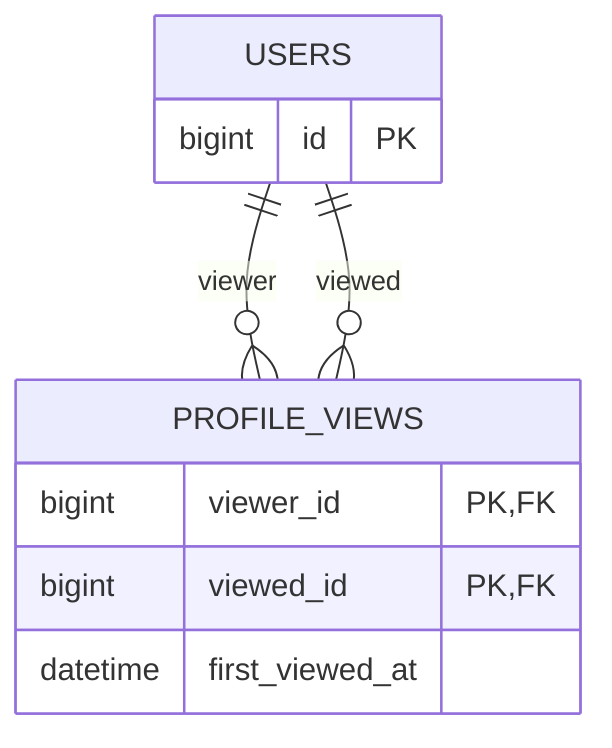

PK는 `(viewer_id, viewed_id)`, 역방향 탐색 인덱스는 `(viewed_id, viewer_id)`다. 자기 방문을 금지한다. A→B는 행 1개이고 B→A가 추가되면 상호 방문이다. 양방향 여부를 별도 컬럼에 중복 저장하지 않는다. 노출 시 현재 계정/프로필 상태를 다시 필터링한다.

## 4. 콘텐츠 원본과 검수 버전 — 후속 설계

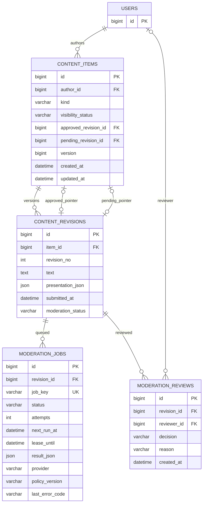

- CONTENT_ITEMS.kind는 WISH/CHEER/COMMENT를 구분한다. visibility_status는 VISIBLE/HIDDEN 등 공개 제어이고 revision 검수 상태와 별개다.
- `UNIQUE(item_id, revision_no)`로 버전을 구별한다. text와 presentation_json은 revision 생성 후 수정하지 않는다. 검수 상태/결과 메타데이터만 갱신한다.
- approved/pending 포인터는 nullable이다. 반드시 같은 item의 revision만 참조하도록 서비스 트랜잭션과 migration의 복합 FK 가능성을 검증한다. FK를 순서대로 생성해 순환 참조를 해결한다.
- 하나의 revision이 재검수될 수 있어 job/review 이력은 여러 개일 수 있다. job_key로 같은 작업 중복을 막고 한 번의 자동 재시도는 attempts/lease로 관리한다.
- reviewer_id는 관리자 판정일 때 사용자 FK, 자동 판정일 때 NULL이다. 자동 판정의 제공자/정책 버전은 작업에 남긴다.
- 동시 수정은 content_items.version과 pending 포인터를 확인한다. 이전 작업은 그 revision의 이력만 남기며 최신 pending을 덮어쓰지 않는다.

## 5. 소원과 댓글 — 후속 설계

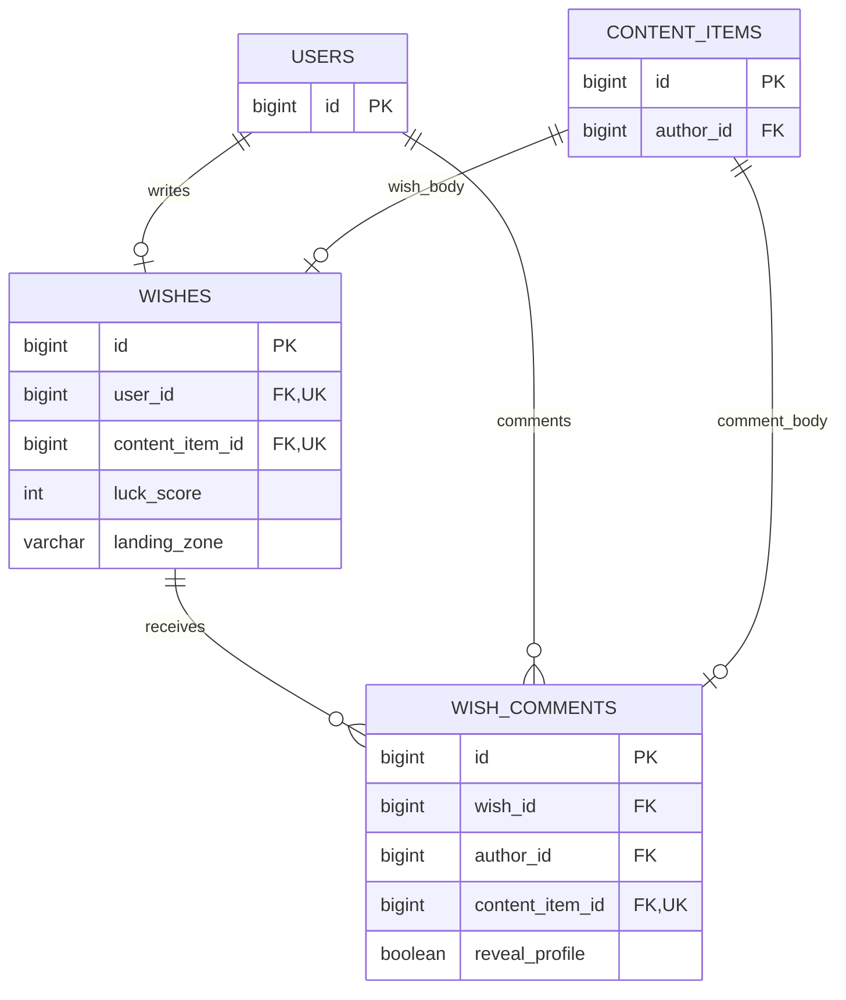

wishes.user_id UNIQUE가 1인 1슬롯을 보장한다. 소원 본문은 revision에 있고 운 점수/낙하 구역은 슬롯에 있어 수정해도 바뀌지 않는다. 댓글은 소원당 여러 개를 허용하지만 댓글 활동상은 타인의 유효한 소원에 남긴 승인 댓글의 `COUNT(DISTINCT wish_id)`다.

도메인 테이블의 작성자와 content_items.author_id가 항상 같은 사용자를 가리키게 검증한다. wishes에는 WISH item만, comments에는 COMMENT item만 연결한다. 공개/승인은 현재 포인터와 visibility로 판정한다. comments 인덱스는 `(wish_id,id)`, `(author_id,wish_id)`를 기본으로 한다.

## 6. 응원 카드와 하트 — 후속 설계

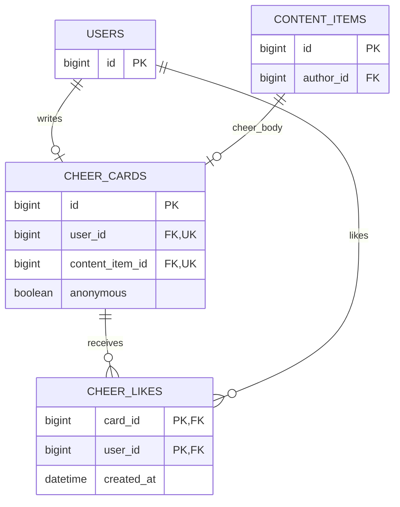

카드 슬롯은 사용자당 1개, 하트는 `(card_id,user_id)` 복합 PK다. 템플릿/허용 스타일은 presentation_json에 넣어 문구와 같은 버전으로 검수한다. 자신의 카드 하트는 서비스에서 거절한다. anonymous가 true인 공개 DTO에는 작성자 식별자를 넣지 않는다.

## 7. 성향과 공식 게임 — 후속 설계

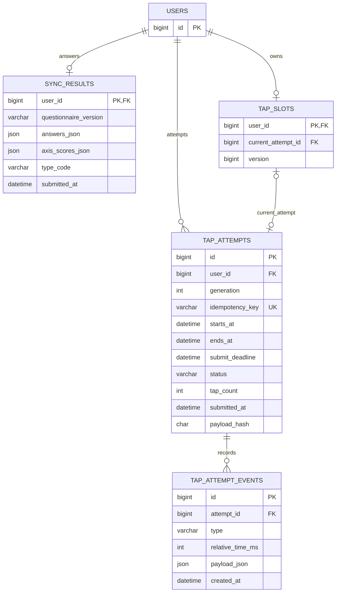

- sync_results.user_id PK로 최초 결과만 보관한다. 문항/유형 점수표는 버전 고정 설정으로 시작하고 결과에 버전을 남긴다.
- tap_slots는 공식 참여 권리, attempts는 도전 이력이다. `UNIQUE(user_id,generation)`으로 차수를 구분하고 관리자 승인 없이 새 공식 시도를 만들지 않는다.
- current_attempt_id는 같은 사용자의 attempt만 가리켜야 한다. 슬롯과 attempt의 생성/포인터 갱신은 한 트랜잭션이며 순환 FK 생성 순서를 검증한다.
- 시작 전 취소는 CANCELLED, 시작 후 중단은 INTERRUPTED 등 이력으로 남긴다. 상세 전이는 [서버 처리 설계](architecture.md)의 게임 상태를 따른다.
- 서버 시작 시각/종료 시각/제출 유예가 기준이다. 이벤트 상대 시간은 검증 보조 데이터이며 브라우저 조작을 완전히 방지하지 못한다.

## 8. 접수 근거와 시상 — 후속 설계

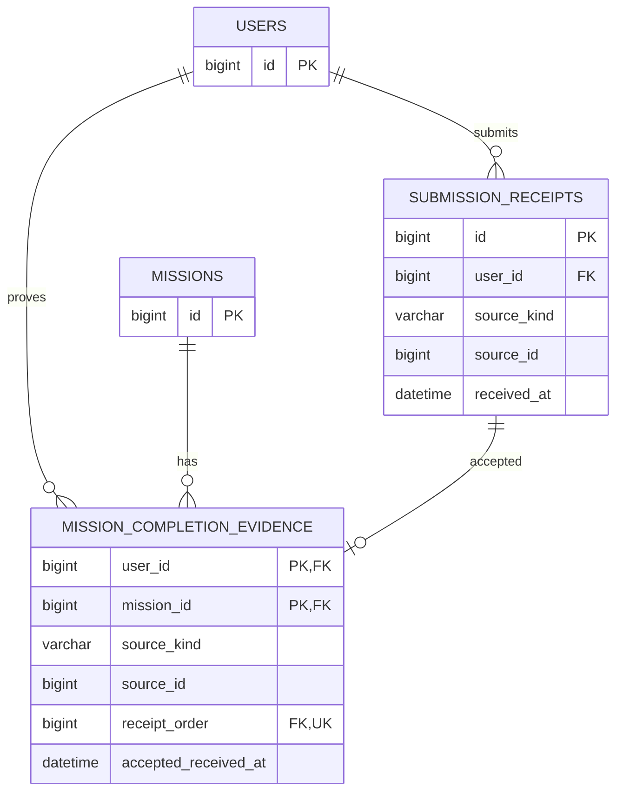

submission_receipts는 콘텐츠 revision, 성향/게임 결과, 프로필 완료 또는 해금 접수의 서버 시각과 고유 접수 ID를 남기는 후속 설계다. 동일 비즈니스 요청 재시도는 기존 영수증을 재사용하며 새 접수 순서를 얻지 않는다. 미션 근거는 유효한 최초 접수만 선택한다. receipt_order가 참조하는 ID와 시각을 승인 처리 시 새로 발급하지 않는다.

source_kind/source_id는 여러 도메인을 참조하는 식별자라 일반 FK 하나로 모든 대상 무결성을 보장할 수 없다. 유효한 소스 존재, 작성자/미션 일치, 승인 상태를 서비스에서 검증한다. 이미 저장된 receipt를 다른 사용자나 소스로 바꾸지 않는다. 같은 소스의 중복 접수 방지용 `UNIQUE(user_id,source_kind,source_id)`를 추가한다. 콘텐츠는 revision ID, 게임은 attempt ID, 최초 프로필은 user ID를 source_id로 사용하며 TAG_UNLOCK은 mission ID로 구분한다. 사용자별로 키를 묶으므로 같은 미션을 여러 사람이 해금해도 충돌하지 않는다.

SHOW ME의 프로필을 태그보다 먼저 완성했다면 유효 완료 근거는 **두 조건이 모두 충족된 해금 접수**다. 그 외에도 해금 이전 행위를 수행 시간으로 인정하지 않는다. accepted_received_at은 해금/유효 수행 두 조건을 만족한 접수 시각이며, 검수 승인 시각과 다르다.

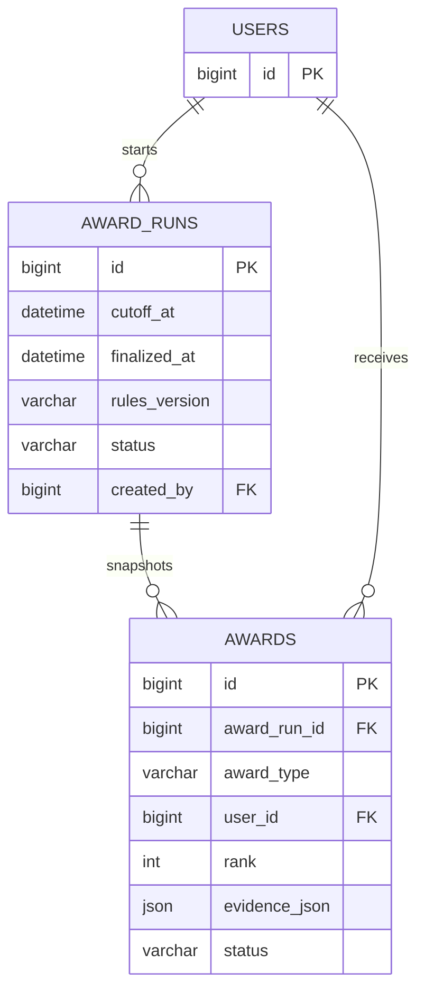

`UNIQUE(award_run_id,award_type,rank)`로 한 정산의 동일 수상 자리를 중복 배정하지 않는다. 재정산은 새 run으로 만들고 발표 이후 정정은 별도 이력을 남긴다. 초기 자동화는 후보 snapshot 생성이며 관리자 최종 확정과 구분한다. 경품 지급 연락처를 별도 수집한다면 목적/보관 기간을 정한 뒤 추가 설계하며 현재 ERD에 이미 있다고 가정하지 않는다.

## 9. 신고, 동의, 설정과 감사 — 후속 설계

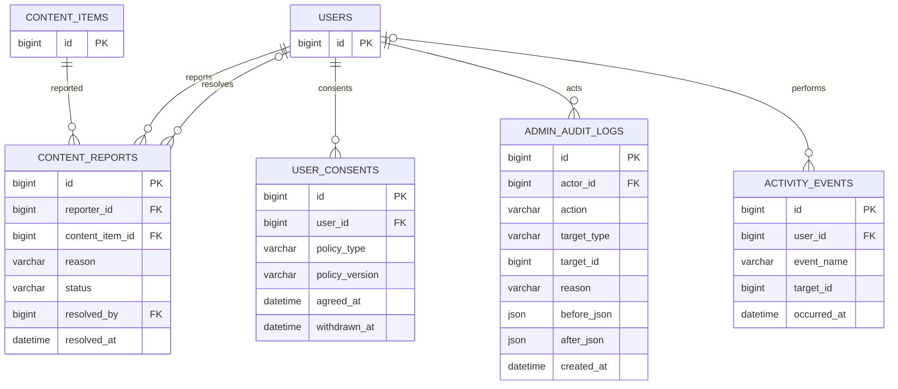

resolved_by는 처리한 관리자이며 미처리 신고에서는 NULL이다. 감사 로그 actor_id는 조치 당시 운영 주체를 가리키며 자동화 주체의 표현은 migration 단계에서 정한다. before/after에는 비밀번호/토큰/불필요한 개인정보를 넣지 않는다. activity_events.user_id는 nullable이며 수집 목적/보관 기간을 확정한 이벤트만 넣는다.

| 테이블 | 컬럼 |
| --- | --- |
| event_settings | id TINYINT PK, opens_at DATETIME, submit_closes_at DATETIME, moderation_closes_at DATETIME, game_duration INT, settings_version BIGINT |

event_settings는 id=1인 단일 행사 설정이다. `opens_at < submit_closes_at <= moderation_closes_at`을 검증하고 game_duration은 양수이며 공식 기본값은 10초다. 카운트다운 5초와 제출 유예/OTP 제한 등 추가 운영 옵션의 컬럼 또는 설정 파일 위치는 migration/API 구현에서 확정한다.

## 10. FK와 인덱스 구현 점검

1. 핵심 10개 테이블은 V1 정의와 일치해야 한다. V2에는 미션과 순번 초기값만 넣고 실제 태그 토큰/개인정보를 시드하지 않는다.
2. 후속 테이블은 부모 → 자식 → nullable 순환 포인터 ALTER 순으로 추가한다. 참조 대상이 같은 사용자/item인지 별도로 검증한다.
3. 콘텐츠 목록 `(visibility_status,id)`, 검수 작업 `(status,next_run_at,id)`, 게임 순위 `(status,tap_count,id)`, 접수 `(user_id,received_at,id)`는 후보 인덱스다. 실제 쿼리/EXPLAIN을 확인하고 migration에 확정한다.
4. 중복 소원/카드/하트/방문/성향/완료는 UNIQUE/PK로 보장한다. UI 버튼 비활성화만으로 중복을 막지 않는다.
5. 완료/시상/감사 기록을 단순 cascade 삭제하지 않는다. 탈퇴/비식별화와 보존 기간은 행사 동의 정책을 따른다.
6. 원문 토큰, OTP와 세션 ID는 ERD의 영속 업무 데이터가 아니다. 세션/OTP/속도 제한은 Redis의 만료 상태로 관리하며 OTP에는 계정/purpose를 바인딩한다. 영속 비밀번호 해시는 후속 user_credentials에만 보관한다.
