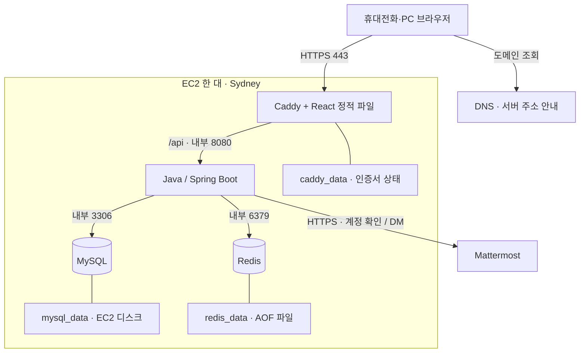
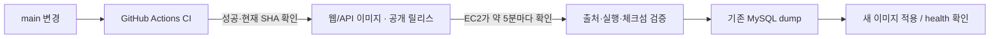

# 서버·DB·Redis 이해하기

TAG ME는 **EC2 한 대 안에서 웹, API, MySQL, Redis를 각각 도커 컨테이너로 실행**한다. 하나의 이미지 안에 전부 넣은 구조가 아니다. 이 문서는 저장소의 현재 실행 설정을 설명하며 실시간 서버 상태나 배포 성공을 뜻하지 않는다.

## 전체 구성

DNS는 도메인을 서버 주소에 연결한다. 요청을 받으면 Caddy가 HTTPS를 처리하고 React 파일을 보내거나 `/api` 요청을 백엔드로 넘긴다. 브라우저가 DB나 Redis에 직접 접속하는 구조는 아니다. 운영 DB/Redis와 API 내부 포트는 외부에 공개하지 않고 Compose 내부 네트워크에서 통신한다.

## 각각 무슨 일을 하나

| 구성 | 역할 | TAG ME 예시 |
| --- | --- | --- |
| EC2 | 운영체제·CPU·메모리·디스크를 제공하는 가상 컴퓨터 | 네 컨테이너가 실행되는 호스트 |
| Docker 이미지 | 실행 프로그램과 필요한 환경을 묶은 배포 파일 | 웹 이미지, API 이미지, MySQL/Redis 공식 이미지 |
| 컨테이너 | 이미지로 실행한 프로세스와 실행 환경 | API를 새 이미지로 교체해도 DB 컨테이너는 별개 |
| Caddy + React | 화면 제공, TLS, API 프록시 | 수집판·게임 화면을 내려주고 API로 연결 |
| Spring Boot | 인증·검증·업무 처리 | NFC 해금, 글자 지급, 1회 도전, 관리자 조정 |
| MySQL | 관계·제약·트랜잭션을 가진 영구 데이터 저장소 | 계정/비밀번호 해시, 프로필, 글·하트, 게임 결과, 방문·감사 |
| Redis | 빠른 단기 상태와 세션 저장소 | 로그인 세션, OTP·시도 제한, 15분 추천 노출 묶음 |
| 도커 볼륨 | 컨테이너 수명과 분리한 데이터 저장 공간 | `mysql_data`, `redis_data`, Caddy 인증서 |

## 로그인부터 미션 저장까지

1. 브라우저가 Caddy를 통해 ID와 TAG ME 비밀번호를 API에 보낸다. API는 MySQL의 비밀번호 해시와 비교한다. Mattermost 비밀번호를 받아 로그인하지 않는다.
2. 성공하면 Redis에 세션을 만들고 브라우저에는 세션을 식별하는 `TAGME_SESSION` 쿠키를 준다. 이후 요청에서도 계정 상태와 credential version을 확인한다.
3. 미션 제출 시 API는 세션·CSRF·행사 기간·프로필/동의·해금·현재 회차를 검사한다. 화면에서 버튼이 보이는 것만으로 참여 권한이 생기지 않는다.
4. API가 MySQL 트랜잭션과 잠금·고유 제약으로 글/게임 결과와 완료 근거를 저장한다. 실패하면 성공한 것처럼 글자를 지급하지 않는다.
5. 화면은 서버 응답을 바탕으로 기록·글자를 표시한다. 소원/응원/댓글은 기본적으로 이 과정에서 바로 공개하며 외부 AI 검수를 기다리지 않는다.

Redis는 MySQL을 대체하는 게임 기록 저장소가 아니다. 추천 묶음도 선정된 ID를 15분 보관해 실제 노출 확인을 검증하는 용도다. 추천 계산은 MySQL에서 수행하며 응원 본문·하트순 전체 결과를 Redis에 캐시하지 않는다.

## 재시작하면 데이터는 어떻게 되나

| 상황 | 영향 |
| --- | --- |
| 웹/API 컨테이너 교체 | DB 기록은 별도 볼륨에 남는다. 처리 중인 요청은 실패할 수 있어 멱등 재시도·상태 재조회가 필요하다. |
| API만 재시작 | Redis 세션을 외부에 저장하므로 유지 가능한 구조지만 계정/자격증명 변경 등 정상 무효화 조건은 그대로 적용된다. |
| MySQL 컨테이너 재생성 | 같은 `mysql_data`를 연결하면 데이터를 다시 사용한다. 새 볼륨을 연결하면 별도 DB로 시작한다. |
| Redis 장애/데이터 유실 | 로그인·OTP·요청 제한·추천 노출 확인이 영향을 받는다. 재로그인이 필요할 수 있지만 MySQL의 프로필·게임 기록이 함께 삭제되지는 않는다. |
| `down -v` 또는 볼륨 삭제 | 해당 볼륨 데이터가 삭제된다. 운영 종료·일반 재배포 방법으로 사용하면 안 된다. |
| EC2/디스크 장애 | 같은 호스트의 모든 서비스가 영향을 받을 수 있다. 볼륨은 서버 밖 백업이 아니므로 별도 보관·복원이 필요하다. |

Redis는 메모리에서 동작하면서 AOF를 볼륨에 기록하도록 설정되어 있다. 이것이 모든 장애에서 최신 쓰기·세션을 완벽히 복원한다는 뜻은 아니다. `noeviction` 정책은 메모리가 찼을 때 기존 키를 임의 제거하는 대신 새 쓰기가 실패할 수 있다는 선택이다.

로컬 fixture는 예외적으로 시작 시 합성 상태를 다시 준비한다. 테스트 계정/더미 변경을 유지하려면 [개발 가이드](development.md)의 재시작 주의를 확인한다.

## 메모리를 사용하는 이유

운영 `compose.small.yml`은 2GiB 호스트를 위한 컨테이너 상한을 둔다. **상한은 현재 사용량이나 미리 확보된 메모리가 아니다.**

| 서비스 | 컨테이너 상한 | 내부 설정 일부 |
| --- | ---: | --- |
| MySQL | 640MiB | InnoDB 버퍼 풀 128MiB, 연결·임시 테이블 등은 별도 |
| Redis | 192MiB | 데이터 maxmemory 64MiB, 프로세스/AOF 처리 등은 별도 |
| API | 768MiB | Java heap 최대 384MiB, 클래스·스레드·네이티브 메모리는 별도 |
| 웹 | 96MiB | Caddy·정적 파일 제공 |

상한의 합은 1,696MiB이며 나머지도 OS·도커 등에 필요하다. DB 버퍼와 JVM을 함께 실행하므로 방문자 수가 적어도 기본 메모리 사용이 있다. 느림을 메모리 문제로 단정하지 말고 CPU·메모리·DB 연결 대기·SQL/API 지연을 함께 측정한다. 현재 문서는 성능 개선 수치를 주장하지 않는다.

## 배포와 백업

새 코드를 배포할 때 운영 서버에서 직접 빌드하지 않는다. 검증된 이미지를 가져와 컨테이너를 교체하며, Flyway가 DB migration을 적용한다. 이미지 교체와 DB 롤백은 별개이므로 이전 이미지만 실행한다고 스키마까지 되돌아가지 않는다.

운영 비밀값은 GitHub 릴리스에 넣지 않고 SSM SecureString에서 서버의 root 전용 환경 파일로 받는다. 서버 내부 dump는 배포 전 복구 자료지만 서버/디스크 유실에 대비한 외부 백업은 아니다. 서버 밖 암호화 보관과 실제 복원 연습은 별도로 확인해야 한다.

## 어디서 무엇을 확인하나

운영 서버의 승인된 접속 세션에서 `docker ps`로 컨테이너 상태, `docker stats --no-stream`으로 메모리·CPU, `df -h`로 디스크를 확인한다. 출력에는 환경변수나 실제 참가자 데이터를 덧붙이지 않는다. 이 문서 작성 과정에서 운영 서버를 재시작하거나 설정을 변경하지 않는다.

| 궁금한 것 | 확인 위치 |
| --- | --- |
| 실제 구성·리소스 제한 | [기본 Compose](../compose.yml), [운영 override](../compose.prod.yml), [소형 서버 상한](../compose.small.yml) |
| 서버가 준비됐는지 | 내부 API `/actuator/health/readiness`, Caddy `/healthz`와 컨테이너 healthcheck |
| 영구 기록·테이블 관계 | [데이터 모델](data-model.md), [ERD](erd.md), Flyway migration |
| 최신 코드가 적용됐는지 | CI·릴리스와 실제 실행 이미지 SHA, [배포 절차](github-actions-ec2.md) |
| 계정/미션 오류를 지원하려면 | [관리자 콘솔](admin-console.md), [지원 조치](support-and-member-controls.md) |
| 장애·마감·백업 대응 | [행사 운영](operations.md) |

DB 내용을 직접 확인할 때는 승인된 로컬 연결/SSM 경로를 사용한다. 운영 MySQL을 인터넷에 열어 Workbench를 연결하는 설정은 사용하지 않는다. 일반 기록 조정은 감사 이력이 남는 관리자 기능을 우선한다.
