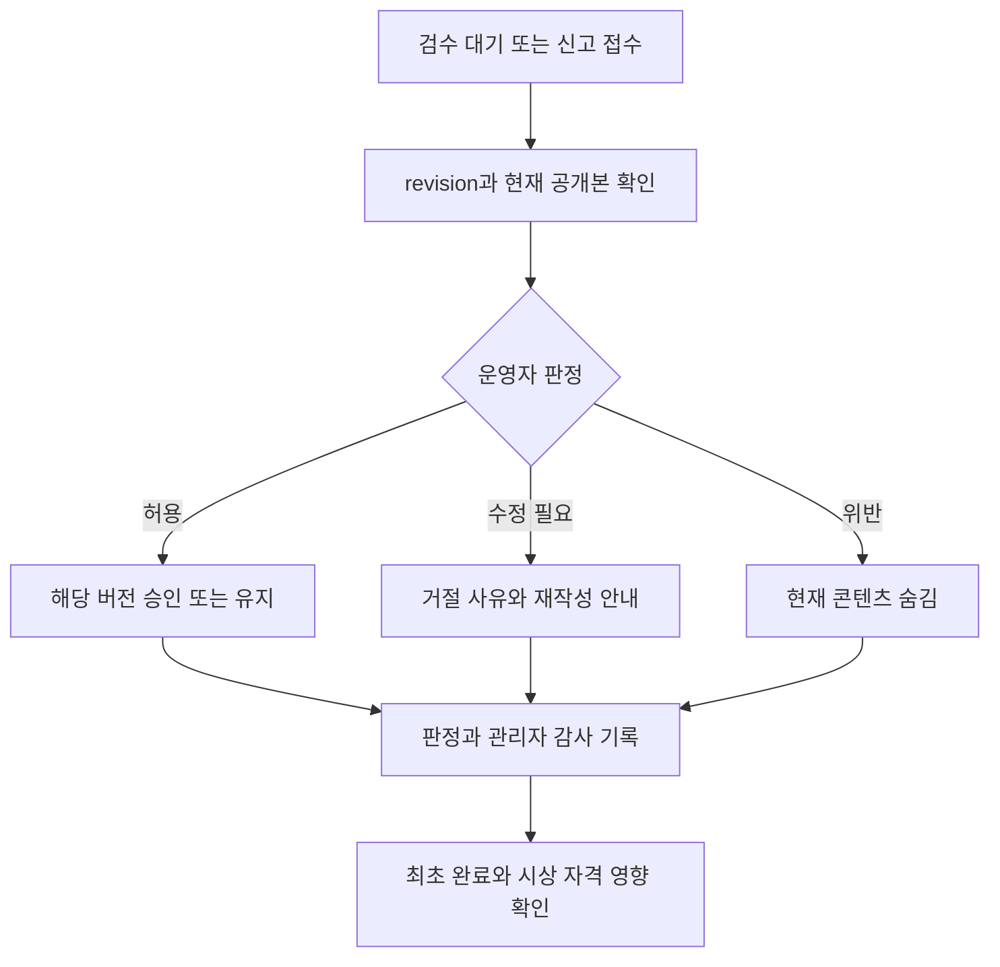

# 행사 운영과 장애 대응 기준

이 문서는 목표 운영 절차이며 관리자 기능이 이미 구현됐다는 뜻이 아니다. 서버 실행/백업 명령은 [개발 및 배포](development.md), 상태와 흐름은 [유저 플로우](user-flows.md), 정산 계산은 [구현 계획](implementation-plan.md)을 함께 따른다.

## 1. 담당과 권한

| 역할 | 책임 |
| --- | --- |
| 행사 운영자 | 일정/장소/힌트/참여 대상/경품/공지/개인정보 정책 확정 |
| 콘텐츠 관리자 | 검수 대기, 신고, 숨김/복구, 판정 사유 기록 |
| 게임/시상 관리자 | 이상 기록/기술 장애 검토, 재도전 승인, 후보 정산과 최종 확정 |
| 개발/인프라 담당 | 배포, 외부 API 권한, 모니터링, 백업/복원과 장애 복구 |

한 사람이 여러 역할을 맡을 수 있지만 ADMIN 권한은 승인된 계정에만 서버 절차로 부여한다. 닉네임이나 프론트 요청값으로 관리자 여부를 정하지 않는다. 중요 변경은 수행자, 사유, 전후 상태를 감사 로그에 남긴다.

## 2. 개장 전 확정할 공지

- 참여 대상은 지정 Mattermost 채널의 SSAFY 16기 서울캠퍼스 교육생이다. 아이디는 Mattermost username이고 비밀번호는 TAG ME 가입 때 설정한다. DM 6자리 인증은 최초 가입과 비밀번호 변경/재설정에 사용하며 일반 로그인은 아이디/비밀번호다.
- 다섯 태그의 탐색 순서는 자유다. 소원/응원 슬롯 각 1개, 성향 결과 최초 1회, 공식 탭 게임 슬롯 1개와 연습 분리를 안내한다.
- 프로필 목록의 닉네임과 상세의 실명/반/소개/링크 공개 범위, 방문 기록과 상호 발견 의미를 설명한다.
- 콘텐츠는 검수 승인 후 공개/완료되며 수정 시 재검수한다. 일상 표현/타인 모욕/혐오/개인정보/광고/도배의 기준을 공지한다.
- 행사 시작, 신규 제출 마감, 검수 정산 마감, 결과 발표 일시를 한국 시간으로 적고 서버에는 UTC로 저장한다.
- 선착순의 유효 접수 시각 기준, 동점, 중복 수상, 공식 게임 장애 예외, 랜덤 추첨의 적격 조건을 미리 정한다.
- 이벤트 후 프로필 공개 유지 여부, 동의 철회/탈퇴, 보관 및 삭제 기간, 문의/신고 경로를 안내한다.

경품 종류/수량/총예산과 확정 일정은 아직 미정이다. 이전 논의의 예산을 현재 확정값으로 게시하지 않는다.

## 3. 배포와 외부 연동 준비

1. Mattermost에서 운영 권한으로 사용자 조회, 지정 채널 멤버십, DM 생성/발송을 검증한다. 개인 토큰 사용이 조직 정책상 허용되는지 확인하고 토큰은 서버에만 둔다.
2. 검수 제공자의 한국어/개인정보 처리 품질과 장애 정책을 확인한다. 이름/반/계정 ID를 보내지 않고 콘텐츠 텍스트만 전송한다.
3. 실제 DNS/HTTPS/쿠키를 설정하고 Caddy만 외부에 공개한다. API/DB/Redis의 공인 포트가 열리지 않았는지 확인한다.
4. 핵심 migration과 후속 migration 적용 결과, Docker 볼륨과 서버 밖 백업, 복원 결과를 확인한다. 백업 파일을 Git에 넣지 않는다.
5. 행사용 관리자 계정과 최소 테스트 계정을 준비한다. 테스트 데이터는 실제 수상 후보에서 제외할 방법을 운영 전에 정한다.
6. 전체 컨테이너 smoke와 테스트 계정의 인증 → 태그 → 다섯 미션 → 완성 → 탐색 → 검수/시상 흐름을 재현한다. 실제 기기 NFC/QR과 탭 게임을 반드시 포함한다.

운영 환경에서 쓰는 실제 코드/키를 공개 문서나 스크린샷에 넣지 않는다. 문서에 있는 placeholder를 실제 값으로 바꾸어 커밋하지 않는다.

## 4. NFC/QR 태그 발급과 설치

1. [참여 계약](participation.md)의 `create-tag-bundle.mjs`로 Git 밖 새 비공개 디렉터리에 32바이트/43자리 태그 URL과 hash-only SQL을 만든다. 도구는 실제 DB를 변경하지 않는다.
2. DB에는 SHA-256 hash, 대상 mission_id, active만 저장한다. 같은 미션에 여러 태그를 연결할 수 있다.
3. 운영 HTTPS 도메인의 `/t/{token}`을 NFC와 해당 QR에 기록한다. 물리 위치/태그 식별/미션 매핑은 공개 저장소 밖의 운영 배포물로 보관한다.
4. 다른 기기로 읽어 올바른 미션을 해금하는지 확인한다. 미인증 진입 후 로그인 복귀, 이미 완료한 계정, 무효/비활성 토큰도 확인한다.
5. NFC를 사용할 수 없는 참가자를 위해 동일 규칙의 QR과 현장 안내를 제공한다. 미션 코드만 입력해 해금하는 우회 경로를 운영 편의로 추가하지 않는다.
6. 유출/오배치 시 기존 태그를 비활성화하고 새 태그를 발급한다. 이미 저장된 해금/완료 기록은 자동 삭제하지 않는다.

태그 URL이 공유되면 다른 인증 사용자도 접근할 수 있다. 이 설계가 현장 존재를 완전히 증명한다고 공지하지 않는다. 공유 방지가 필수라면 행사 전에 추가 확인 수단을 별도 설계해야 한다.

## 5. 행사 상태

| 상태 | 허용 행동 | 차단/운영 행동 |
| --- | --- | --- |
| 개장 전 | 서비스 소개, 허용된 계정/프로필 준비 | 공식 미션 제출/게임 시작은 차단 |
| 행사 진행 | 인증/해금/미션/콘텐츠/반응/탐색 | 계정 상태/횟수/속도/기간 검사 |
| 제출 마감 후 정산 중 | 기존 결과/검수 상태 조회, 관리자 판정 | 신규 해금/미션 제출/댓글/하트 등 시상 영향 쓰기 차단 |
| 최종 확정 후 | 공지된 결과와 동의 범위의 조회 | 확정 run 자동 수정 금지; 정정은 이력 |
| 서비스 종료 | 필요한 종료 안내/문의 | 정책에 따른 공개 중단과 데이터 정리 |

개장 전 프로필 준비 허용 여부와 종료 후 탐색 유지 범위는 운영 확정 항목이다. 마감 이후 콘텐츠 수정은 이전 접수 시각을 물려받지 않는다. 시상에 영향을 주는 새 수정은 원칙적으로 막고 운영자의 숨김/정정은 감사 이력으로 분리한다. 게임은 종료/제출 유예가 마감 전에 끝나는 시작만 허용하는 방향으로 계약을 고정한다.

## 6. 콘텐츠 검수와 신고

- 검수 대기 목록은 콘텐츠 종류, 접수 시각, revision, 자동 판정 이유, 현재 상태를 보여준다. 무조건 최신 버전 승인으로 처리하지 않는다.
- AI 장애/불확실 판정은 REVIEW_REQUIRED로 둔다. 자동 승인으로 우회하지 않는다.
- 수정본 거절은 기존 승인본을 삭제하지 않는다. 기존 승인본 자체가 문제라면 별도 숨김 조치를 한다.
- 숨김 콘텐츠/댓글은 공개 목록과 시상 집계에서 제외한다. 이미 기록된 최초 완료는 삭제하지 않고 자격 판정을 분리한다.
- 익명 게시물도 내부적으로 검수/신고할 수 있으나 공개 응답에 작성자 식별자를 노출하지 않는다.
- 신고 처리의 승인/거절/숨김/복구는 사유와 처리자를 남기며 중복 판정은 현재 상태를 확인해 멱등하게 처리한다.

## 7. 공식 게임 장애 및 재도전

| 상황 | 기본 처리 | 운영 확인 |
| --- | --- | --- |
| 서버 시작 전 취소 | 기회 유지 | 서버 현재 시각이 starts_at 이전인지 확인 |
| 정상 종료 | 기회 소진 | 유효 결과와 이벤트 수 확인 |
| 시작 이후 의도적 이탈 | 기회 소진 | 중단 상태와 visibility 이력 확인 |
| 종료 후 전송 실패 | 같은 attempt 복구/재전송 | starts_at/ends_at/제출 유예/최초 payload 확인 |
| 명백한 기술 장애 | 관리자 승인 시에만 재도전 | 장애 사유/기기/관련 서버 기록과 승인자 보관 |
| 비정상 고득점/규칙적 입력 | 검토 대기/무효 판단 | 브라우저 데이터 조작 가능성을 고려해 후보 확인 |

재도전은 공식 슬롯을 삭제하는 것이 아니라 새 generation의 attempt를 만들고 current_attempt_id를 변경하는 조치다. 이전 attempt/events/판정은 보관한다. 같은 승인 요청 재전송으로 여러 새 attempt가 생성되지 않게 멱등 키와 행 잠금을 사용한다. 임의로 점수만 수정하지 않는다.

## 8. 수상 후보 정산과 발표

1. 제출 마감 시각 이전의 접수만 후보로 고정한다. 정산 마감까지 검수/게임 보류를 처리한다. 어떤 보류가 남으면 자동으로 유효 처리하지 않고 사전 공지 기준을 적용한다.
2. 전체 완성상은 다섯 미션의 최초 유효 접수 시각 중 최댓값으로 계산한다. AI 승인 처리 순번을 선착순으로 사용하지 않는다.
3. 동일 시각은 마지막 유효 근거의 접수 ID, user_id 순으로 정렬하는 개발 기본안을 사용하되 공지와 일치시킨다. 해금 전 프로필 입력은 해금 시점보다 앞선 완료로 인정하지 않는다.
4. 댓글 활동상은 타인의 유효한 소원에 남긴 승인 댓글의 서로 다른 wish_id 수다. 자기/반복/숨김/무효 댓글을 제외한다.
5. 응원 반응상은 유효 공개 카드의 서로 다른 사용자 하트다. 자기 하트를 제외하고 마감 이후 반응을 추가하지 않는다.
6. 게임상은 유효한 공식 current attempt만 대상으로 관리자 검증 후 계산한다. 동점/제출 지연/재도전 승인 정책을 적용한다.
7. 랜덤상은 공지된 적격 사용자 집합을 고정하고 추첨 결과와 정산 run에 근거를 보관한다.
8. 중복 수상/계정 제한/무효 참여/운영 테스트 계정을 검토하고 결과 snapshot을 승인한다. 실제 확정과 발표를 구분하며 발표 후 정정에는 사유와 새 이력을 남긴다.

수상 확정 전 UI에는 잠정/검토 상태를 표시한다. 경품 발송 자체는 현재 API/ERD 범위에 구현되지 않았다. 지급이 필요하면 별도 수집 목적과 연락 방식, 보관 기간을 확정한다.

## 9. 운영 대시보드 최소 기능

| 영역 | 필수 정보/행동 |
| --- | --- |
| 회원 | 검색, 상태, 공개 여부, 참여 이력, 이용 제한 |
| 미션/태그 | 해금/완료/전체 완료, 힌트, 태그 활성/교체 |
| 콘텐츠 | 종류/상태별 목록, 승인본/대기본, 신고와 숨김/복구 |
| 검수 | 대기 시간, 실패 코드, 재처리/관리자 판정 |
| 게임 | 슬롯/시도/중단/검증 상태, 재도전 승인 |
| 시상 | 규칙 버전/마감 시각, 후보/근거, 최종 확정/정정 |
| 행사 | 개장/마감/정산 설정과 설정 버전 |
| 감사 | 수행자/사유/대상/전후 상태/시각 |

최초 운영에는 복잡한 통계 차트보다 처리 가능한 목록과 오류 복구를 우선한다. 조회로 승인/추첨/확정이 실행되지 않게 한다.

## 10. 장애 대응표

| 증상 | 확인 순서 | 처리 기준 |
| --- | --- | --- |
| 가입/변경/재설정 DM 미도착 | purpose/rate limit/계정/채널/외부 권한/발송 오류 | 고정 코드로 우회하지 않고 재요청/장애 안내 |
| 비밀번호 로그인 실패 | Mattermost username/내부 ID/해시 존재/계정 상태/시도 제한 | Mattermost 비밀번호를 요청하지 않고 본인 DM 기반 재설정 안내 |
| 세션 유실/Redis 실패 | Redis 상태/메모리/noeviction/쿠키/HTTPS | 재인증 안내, DB 미션/콘텐츠 기록 유지 |
| 검수 적체 | 작업 상태/lease/재시도/제공자 오류 | 제한 재시도와 보류 목록 처리, 승인 지연 공지 |
| 중복/순번 문제 | 복합키/트랜잭션/잠금/롤백/감사 | 데이터 덮어쓰기 전에 원인과 근거 보존 |
| 게임 오작동 | 기기/시각/중단/event/payload/제출 유예 | 개별 검토와 승인 이력, 자동 재도전 금지 |
| DB/API 장애 | readiness/컨테이너/디스크/커넥션/DB 로그 | 쓰기 중단 판단, 검증한 백업 복원/이미지 롤백 |
| 태그 오배치/유출 | 물리 태그와 미션 매핑/활성 상태 | 태그 교체, 기존 참여 이력 보존 |

비밀번호/해시/OTP/토큰/개인정보 원문을 로그에 더 찍는 방식으로 장애를 추적하지 않는다. requestId/jobId/내부 상태 등 필요한 최소 정보로 연결한다. 운영자가 비밀번호를 조회/전달하거나 공용 비밀번호로 바꾸지 않는다. 변경/재설정 후 현재/다른 기기의 이전 세션이 모두 거절되는지 확인한다.

## 11. 종료 및 인수인계

- 정산 run과 최종 결과, 관리자 판정/정정 근거를 보관 정책에 맞게 정리한다.
- 종료 후 프로필을 계속 공개하려면 그 목적의 동의를 확인하고 비동의 계정은 공개 목록/그래프에서 제외한다.
- 원문 태그 URL을 비활성화하고 임시 테스트 계정/권한/외부 토큰을 정리한다.
- 개인정보/콘텐츠/방문/분석/백업을 각각 정한 기간에 삭제 또는 비식별화한다. 운영 DB를 삭제해도 백업의 정책이 자동 적용되는 것은 아니다.
- 최종 배포 커밋/이미지, migration 버전, 백업 복원 방법, 미해결 장애/미확정 정책, 담당자를 남긴다.

V4 행사 설정/현재 정책은 운영자가 확정해야 하며 미설정 시 참여 쓰기는 차단된다. 정책은 버전별 원문을 보존하고 현재 포인터만 바꾼다. 동의 철회는 마감 후에도 가능하며 완료 이력과 시상 자격을 분리한다.

V5 성향 문항 초안은 운영에 자동 반영되지 않는다. [결과 계약](results.md)의 설정/버전 절차로 확인한다. FAST TAP의 공식 기록은 잠정 결과이며 검토/재도전/공개 순위 확정은 후속이다. 5/10/5초 참여·유예와 실제 기기/현장 지연을 개장 전에 확인한다.
