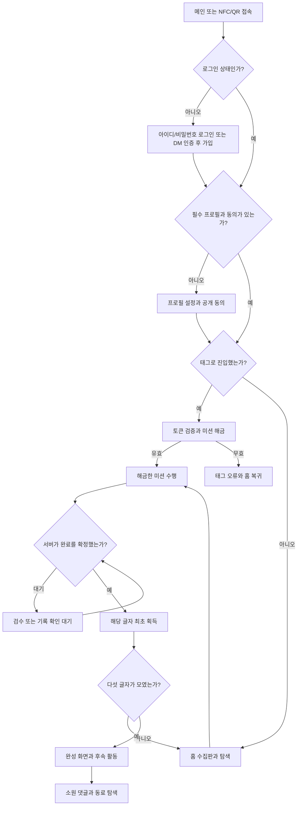
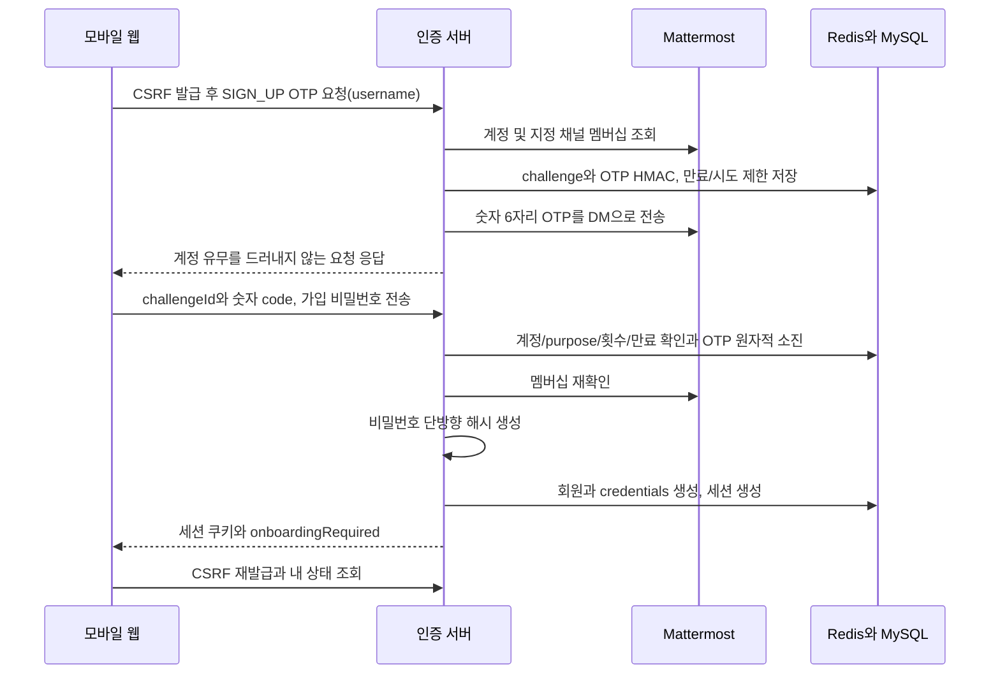
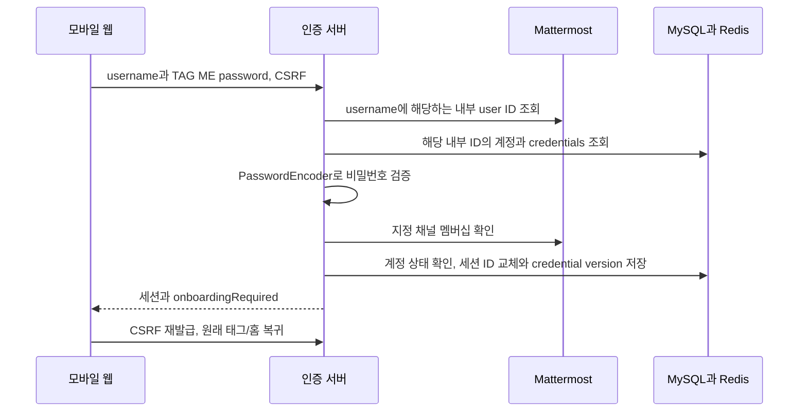
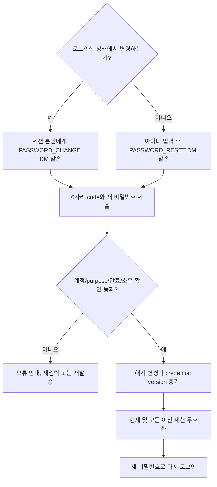
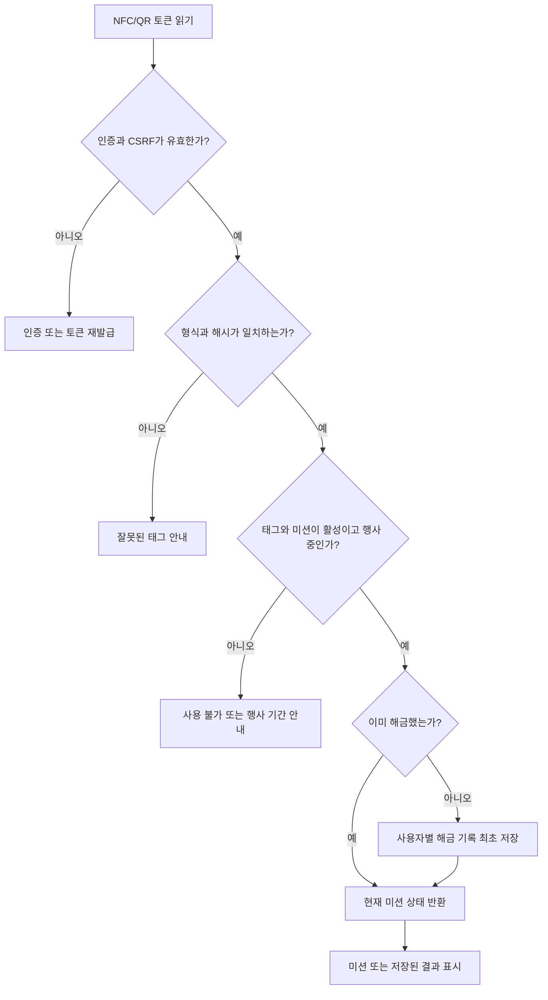
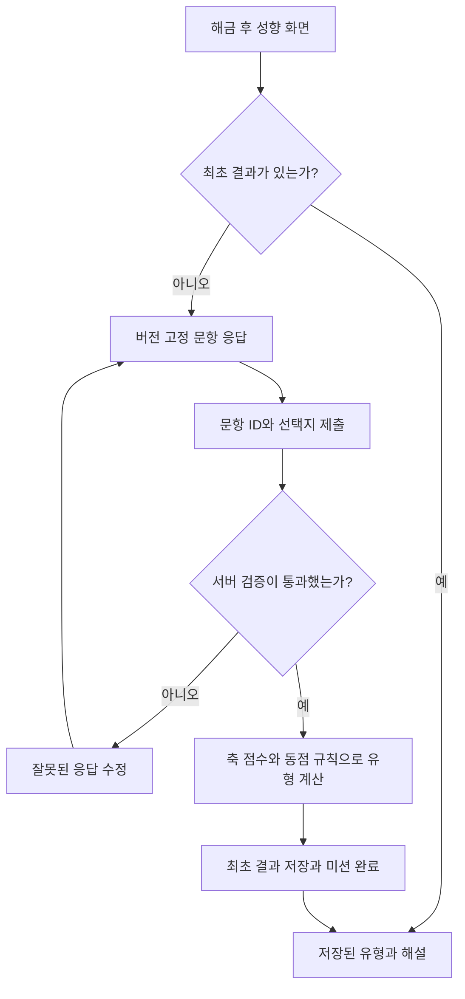
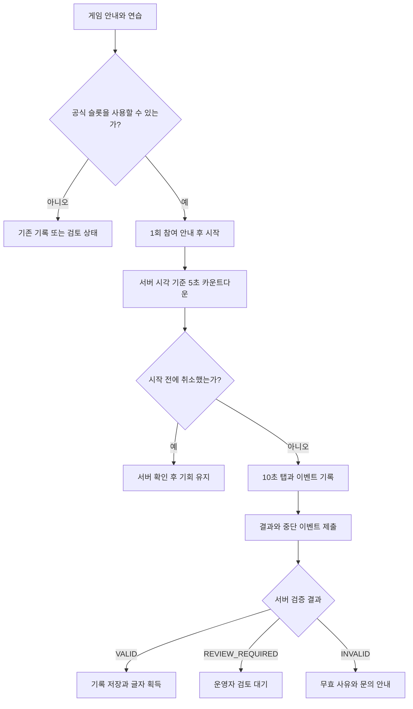
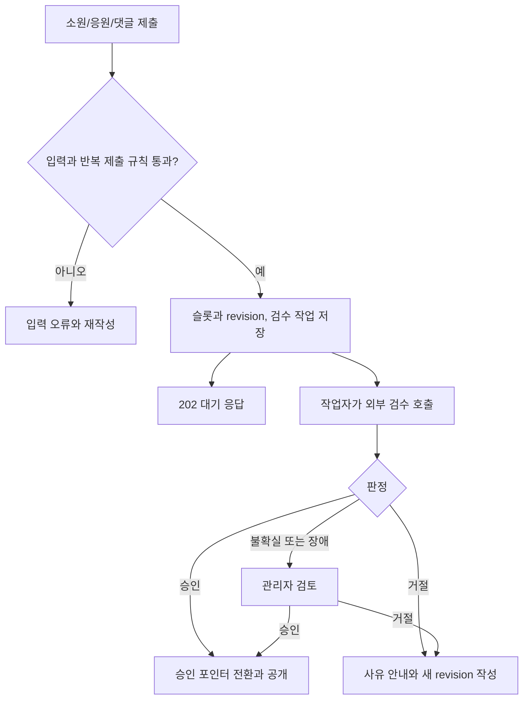
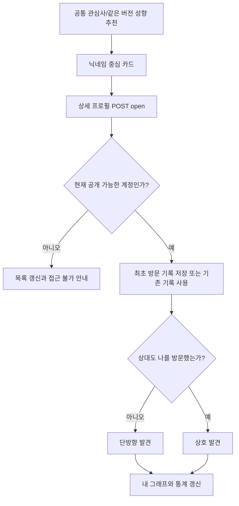
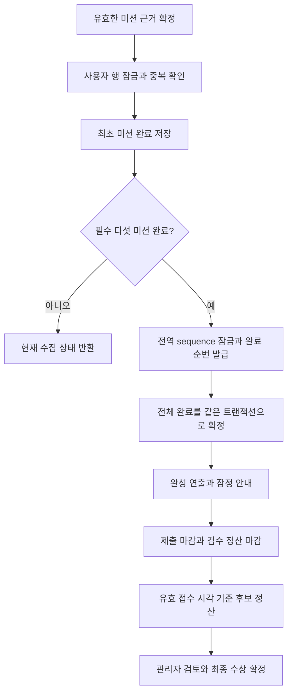

# 유저 플로우와 상태 전이

이 문서는 목표 사용자 경험의 설계다. 실제 구현 범위는 [문서 안내](README.md)의 상태 표를 따른다. 로그인과 미션 해금 여부는 화면 표시와 별개로 서버에서 확인한다.

## 1. 전체 참여 흐름

홈에서 미션을 고를 수 있어도 미해금 미션은 힌트/태그 안내만 보여준다. 해금 후 수행 순서는 자유다. 검수 대기 중에는 다른 해금 미션이나 동료 탐색으로 이동할 수 있다. 거절/무효 결과는 해당 기능의 수정/검토 안내로 분기하며 완료 글자를 주지 않는다.

## 2. 메인 접속과 태그 접속의 차이

| 진입 | 로그인 전 | 로그인 후 |
| --- | --- | --- |
| 메인 `/` | 서비스 소개와 인증 안내 | 수집판/현재 상태 조회 |
| `/t/{token}` | 태그를 임시 보존하고 아이디/비밀번호 로그인 또는 신규 가입으로 연결 | 서버 resolve 후 해당 미션 진입 |
| 미션 화면 직접 입력 | 인증으로 연결 | 해금 여부 확인 후 미해금이면 잠김 안내 |
| 만료된 세션에서 재접속 | 재인증 | DB에 남은 해금/결과/검수 상태 복구 |

태그 원문을 로그인 쿼리나 외부 URL에 덧붙이지 않는다. 같은 탭의 임시 상태와 내부 복귀 경로를 사용한다. 임시 상태가 유실되면 태그를 다시 읽게 안내하고 서버 해금 기록은 유지한다. QR과 NFC는 같은 토큰 해금 규칙을 사용한다.

## 3. 인증 및 최초 프로필

일반 로그인은 Mattermost username과 TAG ME 가입 시 정한 비밀번호다. DM OTP 단독 로그인은 사용하지 않는다. 세부 API/저장/보호 기준은 [인증 설계](auth.md)를 따른다.

### 최초 가입

서버가 유효한 계정/멤버십을 확인한 경우에만 가입용 OTP를 발급하고 DM을 보낸다. 비대상/이미 가입/발송 실패는 내부에서 구분하되 외부 응답이 불필요한 계정 정보를 노출하지 않게 한다. OTP 소비 이후 외부/DB 장애가 나면 가입을 성공으로 처리하지 않고 새 발급 절차를 안내한다. 기존 회원의 비밀번호를 가입 요청으로 덮어쓰지 않는다.

### 일반 로그인

위 시퀀스는 검증에 성공한 경로다. 계정 없음/비밀번호 불일치/범위 밖/제한 계정/외부 장애에서는 세션을 만들지 않는다. 로그인할 때마다 DM 인증을 요구하지 않는다. Mattermost 비밀번호를 서버로 받아 대리 로그인하지 않는다.

### 비밀번호 변경과 분실 재설정

변경 대상은 세션의 본인이고 분실 재설정 대상은 DM 소유가 확인된 기존 회원이다. 가입용 코드를 변경/재설정에 재사용할 수 없다. 재설정은 신규 계정을 만들지 않으며 성공 후 자동 로그인하지 않는다.

- 입력은 숫자 6자리 문자열이고 앞자리 0을 허용한다. 전체 코드 붙여넣기와 모바일 숫자 키패드를 지원한다.
- 제안 기본값: 유효시간 3분, 계정별 재발송 간격 60초, challenge별 오답 5회. IP와 계정 제한을 함께 적용한다.
- 재발송하면 이전 challenge를 무효화한다. 인증 성공 후 이전 코드는 재사용할 수 없다.
- 목적과 외부 내부 ID를 challenge에 묶고 비밀번호 변경용은 현재 사용자와도 묶는다. 새 비밀번호는 해시만 저장하고 DM/로그/URL/응답에 넣지 않는다.
- 가입 인증 뒤 Mattermost에서 이름·지역·반·사진을 가져와 보여준다. 닉네임만 필수이며 관심사(도메인/기술 스택 복수), 한 줄 소개, 블로그/GitHub는 선택이다. 가져온 값은 수정 입력을 받지 않고 형식 오류 시 원본 수정·재인증을 안내한다. [가입 계약](mattermost-profile.md)을 따른다.
- 프로필 저장 전 공개 범위를 명확히 안내한다. 동의를 거절하면 SHOW ME를 완료한 것으로 처리하지 않고 안내/로그아웃 경로를 제공한다.
- 프로필을 먼저 완성해도 SHOW ME 태그가 잠겨 있으면 첫 번째 S는 아직 받지 않는다.

## 4. 태그 검증과 해금

같은 태그를 다시 읽어도 해금/완료 시각을 갱신하지 않는다. 서버의 미션 코드로 이동 대상을 정하고 토큰에 임의의 화면 주소를 넣어 이동시키지 않는다. 태그 복제/URL 공유는 가능하므로 실제 현장 인증 장치라고 설명하지 않는다.

## 5. 다섯 미션의 상세 흐름

### 5.1. SHOW ME — 첫 번째 S

`태그 해금 → 기존 프로필/동의 확인 → 미완성이면 입력 → 서버 검증/저장 → 최초 완료 → 글자 획득`

이미 유효한 프로필과 동의가 있다면 입력을 반복시키지 않고 해금 시 재평가한다. 이후 수정은 최초 완료 시각을 바꾸지 않는다. 참가자 비공개 기능은 없다. 계정 제한/미완성/옛 동의 계정은 상세·추천·그래프에서 제외하고 기존 완료는 보존한다. 시상 자격은 운영 정책으로 별도 판단한다.

### 5.2. SYNC ME — 두 번째 S

진행 중 답변은 같은 탭의 임시 상태로 복원할 수 있다. 결과 확정 후 재제출은 기존 결과를 반환하며 새로운 유형을 주지 않는다. 클라이언트가 보낸 유형 코드나 점수를 신뢰하지 않는다. 질문/축/유형 이름은 아직 미확정이며 결과 화면에는 전문 진단이 아닌 행사 콘텐츠임을 안내한다.

### 5.3. MAKE A WISH — A

`소원 호수 → 소원 입력 → 동전 던지기 → 슬롯/revision 저장과 A 획득 → 분수 위 안착 → 승인본 공개`

운 점수와 낙하 구역은 서버가 최초 슬롯 생성 시 결정해 보관하고, 승인 전에는 공개 호수에 노출하지 않는다. 접수 성공 후 동전 안착을 보여주며 새로고침으로 운 결과를 다시 추첨하지 않는다. 거절되면 같은 슬롯에 새 revision을 제출한다. 승인된 소원을 수정하는 동안에는 기존 승인본을 보여주고 대기본은 작성자에게만 표시한다.

다른 공개 소원을 열어 댓글을 남길 수 있다. 댓글은 검수 후 공개하며 프로필 연결 공개 여부를 선택한다. 자기 소원 댓글과 같은 소원에 반복한 댓글은 댓글 활동상 점수를 늘리지 않는다.

### 5.4. FAST TAP — F

연습은 공식 슬롯을 소비하지 않는다. 게임이 시작된 후 이탈하면 기회가 소진된다. 전송 실패 시 새 게임을 만들지 않고 현재 attempt를 조회한 뒤 같은 결과를 재전송한다. 기술 장애의 예외 재도전은 운영자 승인으로 새 attempt를 생성하고 이전 이력을 보존한다. 검토 대기 결과에 먼저 글자를 지급하지 않는다.

### 5.5. SAY SOMETHING — Y

`응원 카드 목록 → 템플릿/문구/익명 여부 선택 → 미리보기 → 제출 → 검수 대기 → 승인 후 카드 공개/글자 획득`

카드는 사용자당 슬롯 하나다. 미리보기와 서버 허용 스타일을 일치시키고 임의 HTML/CSS는 받지 않는다. 익명 카드의 공개 응답에는 작성자 ID나 프로필 링크를 포함하지 않는다. 하트 등록/취소는 각각 멱등하게 처리하고 자신의 카드 하트는 막는다. 수정과 재검수는 소원과 같은 버전 규칙을 따른다.

## 6. 콘텐츠 검수와 수정

댓글 승인 자체로 수집 글자를 지급하지 않는다. 검수 요청에는 콘텐츠만 보내고 이름/반/Mattermost ID는 보내지 않는다. 이전 revision의 늦은 응답이 현재 수정본을 승인한 것처럼 반영되지 않도록 job/revision/pending 포인터를 함께 검사한다. 서비스는 대기 상태를 조회해 갱신하는 방식으로 시작하며 실시간 소켓은 필수 구성에 넣지 않는다.

## 7. 동료 탐색과 발견 그래프 — 페이즈 5-1 구현

목록은 닉네임/관심사/공개 가능한 유형을, 상세는 가져온 이름/지역/반/사진과 입력한 소개/관심사/외부 링크를 보여준다. 내부 Mattermost ID는 숨긴다. 프로필을 단순 GET으로 열어 방문 기록을 우회하는 별도 경로를 제공하지 않는다. 과거 비공개/미완성/정지/탈퇴 계정은 노드, 간선, 통계, 추천에서 모두 제외한다. 그래프는 내 관계만 반환하고 타인의 전체 관계망을 제공하지 않는다. 본인도 현재 완성된 공개 프로필/두 동의가 필요하며 미달 시 내 프로필로 안내한다. 목록/검색/뒤로가기에는 방문이 생기지 않고 상세 진입의 CSRF POST로만 저장한다. 현재 경로의 인증 확인이 끝나기 전에 상세를 열지 않는다. 상세 재열기/본인 열기도 OPEN 기간에만 가능하며 마감 뒤 목록/관계 조회와 구분한다. 그래프는 그림 8명/목록 30명, 전체 집계는 별도다. 오류를 가짜 동료나 0으로 대체하지 않는다. [탐색 계약](discovery.md)에 필터/재시도/상한을 정리했다.

## 8. 전체 완료와 시상

운영상 완료 순번은 승인 처리 순서이고 선착순 수상 순위가 아니다. 화면은 둘을 혼동시키지 않는다. 최종 수상은 검수 지연, 무효 기록, 동점, 중복 수상 정책을 반영한 뒤 발표한다.

## 9. 재접속/장애/마감 복구표

| 상황 | 서버 기준 | 사용자 화면과 다음 행동 |
| --- | --- | --- |
| 가입/비밀번호 인증 중 새로고침 | 유효 purpose/challenge/재발송 정책 | 보존 가능하면 남은 시간 표시, 유실 시 재요청; 비밀번호는 임시 저장하지 않음 |
| 비밀번호 변경/재설정 후 기존 탭 사용 | credential_version 불일치로 이전 세션 거절 | 다시 로그인, 공식 미션/결과는 DB에서 복구 |
| 태그 resolve 중 응답 유실 | 해금 복합 PK로 중복 방지 | 같은 태그 재요청 후 현재 상태 표시 |
| 소원/응원 제출 중 응답 유실 | Idempotency-Key와 사용자 슬롯 UNIQUE | 내 슬롯 조회 후 결과 복구; 새 슬롯 생성 금지 |
| 검수 대기 중 이탈 | DB 작업/revision 보존 | 재접속 시 대기/승인/거절 현재 상태 조회 |
| 게임 중 잠금/백그라운드 | 서버 시작/종료 시각과 중단 이력 | 현재 attempt 조회; 자동 기회 복구 금지 |
| 프로필 조회 중 계정·자격 변경 | 현재 공개 상태와 행 잠금 | 접근 불가 안내 및 노드/통계 갱신 |
| 제출 마감 | 서버 시각과 접수 기록 | 신규 제출 차단, 기존 대기본 처리 상태 확인 |
| Redis 장애 | 인증/세션을 정상으로 간주하지 않음 | 일시 장애 안내, DB의 공식 기록은 유지 |
| AI 장애 | 무검수 공개 금지 | 대기/관리자 검토 안내, 다른 활동으로 이동 |

페이지 로컬 상태와 애니메이션은 공식 기록의 근거가 아니다. 앱 복귀 시 내 계정, 수집판, 내 콘텐츠와 현재 게임 상태를 서버에서 다시 조회한다.

페이즈 3의 실제 복귀/동의/기간/완료 동작과 API는 [참여 계약](participation.md)을 따른다. 익명 태그 의도는 원문 없이 서버 세션 hash로 15분 보관하며, 로그인 중 새로고침 후에도 `/t/resume`으로 이어간다.

페이즈 4-1에서 SYNC 최초 결과와 FAST TAP 공식/연습을 연결했다. 새로고침 뒤 결과는 서버에서 다시 읽고, 진행 중 게임의 입력을 복원하거나 새 기회를 만들지 않는다. 동점/문항 버전/기한/중단 상세는 [결과 계약](results.md)을 따른다.

## 페이즈 4-2 실제 구현 경계

소원/응원은 최초 슬롯 작성과 글자 지급 → 비공개 검수 → 승인본 공개 → 같은 슬롯 수정/재검수로 이어진다. 수정 중에는 기존 승인본의 문구와 익명 여부를 유지한다. 응답 유실은 같은 요청 재전송 또는 내 슬롯 새로고침으로 복구한다. 댓글/하트는 페이즈 4-3에 연결했다. 운영 관리자 화면과 실제 업체 연결은 후속이다. 세부 상태와 현재 경로는 [콘텐츠 계약](content.md)을 따른다.

## 페이즈 4-3 실제 댓글·하트

소원 목록 → 댓글 보기 → 공개 댓글/본인 접수 내역 → 익명 기본 또는 닉네임 표시 선택 → 검수 요청 → 비공개 대기 → 승인 후 공개로 이어진다. 응답 유실은 동일 키 재전송 또는 본인 requestKey 확인으로 복구한다. 응원 목록은 하트 상태를 한 번에 조회하고 등록/취소를 서버 값으로 확정한다. 변경 실패 시 숫자를 조작하지 않는다. 승인된 공개 설정 댓글/비익명 응원만 nullable profileId로 상세 화면에 연결한다. 익명 글에는 프로필 링크를 만들지 않고 콘텐츠 ID를 프로필 ID로 사용하지 않는다.

## 페이즈 5-2 관리자 작업 흐름

`/admin` 진입 → 세션/현재 ADMIN 확인 → 검수 상태·커서 목록 → 항목 선택 → 접수본/승인본 비교 → 조치 확인창의 대상·영향 확인 → 사유 입력 → 현재 fence/버전으로 요청 → 서버 상태 재조회로 이어진다. 모바일은 선택한 상세와 목록을 한 번에 한 영역만 보여주며 뒤로가기/목록 복귀를 제공한다.

응답 유실/409는 추가 요청을 막고 GET 재조회로 실제 처리 결과를 확인한다. 승인 요청도 참가 조건이 부족하면 REVIEW_REQUIRED일 수 있다. 콘텐츠 탭의 숨김은 공개 목록·댓글 부모 조건에 반영하되 기존 승인/글자/접수 기록을 지우지 않는다. 복구는 자동 승인/검수 재개가 아니다. 감사 탭은 실제 조치자/대상/사유/변경 메타데이터를 보여준다. 일반 계정·권한 회수는 원문을 숨기고 비공개 조회를 멈춘다. [운영 계약](operations-admin.md)을 따른다.
