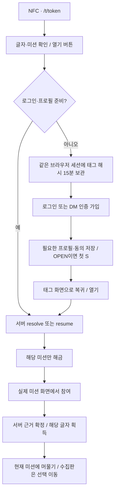
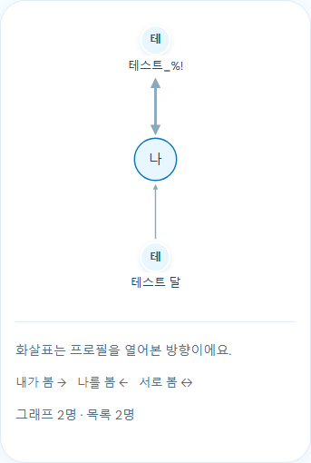

# 유저 플로우

## 1. 가입과 프로필

1. 참가자가 Mattermost 아이디를 입력한다. 이미 활성 가입된 아이디는 `ACCOUNT_ALREADY_REGISTERED`로 안내하고 DM 단계로 보내지 않는다.
2. 서버가 등록 가능한 계정·채널 자격을 확인하고 DM으로 숫자 6자리 인증번호를 보낸다.
3. 인증번호와 새 TAG ME 비밀번호(8~20자)를 제출하면 계정을 만들고 로그인 세션을 시작한다.
4. Mattermost 기본 정보와 TAG ME 닉네임·소개·관심사를 확인해 프로필을 저장한다.
5. 한 줄 소개와 산업/개발 분야 각각 1~3개, 현재 참여·공개 동의를 저장한다. 행사 OPEN이면 SHOW ME와 첫 번째 `S`를 지급하고, 사전 등록은 OPEN 이후 인증된 POST 재평가로 지급한다.

재방문자는 아이디·TAG ME 비밀번호로 로그인한다. 비밀번호 변경·재설정에는 목적별 DM 인증이 다시 필요하며, Mattermost 비밀번호는 받지 않는다.

## 2. 미션 발견과 글자 수집

태그 페이지 열기 자체는 해금이 아니다. 먼저 inspect로 해당 미션을 표시하고 ‘열기’ 동작에서 resolve/resume을 호출한다. 로그인 전 의도는 같은 브라우저 세션의 해시로만 보관하며 만료 시 실물 NFC를 다시 읽는다. 프로필 저장 뒤 유효한 보관 태그가 있으면 `/t/resume`, 없으면 마이페이지로 이동한다.

홈의 수집판은 각 미션을 `잠김 → 진행 가능 → 완료`로 표시한다. SHOW ME를 제외한 미션은 `/t/{token}`을 열었을 때 서버가 원본 토큰의 해시·행사 상태·사용자 상태를 검증한 뒤에만 해금된다.

### SYNC ME

한 화면에 한 질문씩 총 9개를 답한다. 이전 질문으로 돌아가도 선택은 유지되며 마지막에만 결과를 저장한다. 결과에는 8개 유형 중 자신의 캐릭터와 설명, 같은 문항 버전에서 같은 유형을 받은 동료가 표시된다. 최초 결과는 다시 제출하지 않는다.

### A WISH COME TRUE

첫 소원을 등록하면 종이배가 접혀 호수에 띄워지는 짧은 연출 뒤 글자 획득 안내가 이어진다. 호수에는 여러 소원이 종이배로 표시되고, 새로고침하면 같은 세션에서 이미 본 소원을 가급적 제외한다. 호수와 목록은 같은 상세 화면을 사용하며 댓글 작성·본인 댓글 삭제, 이전/다음 소원 탐색을 제공한다. 내 소원에서는 댓글 수와 댓글 내용을 바로 확인하고 소원을 수정할 수 있다.

### FAST TAP

연습과 공식 도전을 분리한다. 공식 도전은 서버가 시작·종료 시각과 현재 reset generation을 검증하며 한 번의 유효 결과만 현재 기록으로 인정한다. 5초 준비 중에는 취소 가능하고, 10초 플레이 시작 후 중단/만료는 공식 기회를 사용한 것으로 기록한다. 순위는 공식 종료 후에만 상위 10명과 본인 순위를 표시한다. 10위 진입 시 50자 한마디 1회 권한을 저장하며 이후 밀려나도 유지한다.

### YOU GOT THIS

400자 내 응원을 10색 중 선택해 익명 또는 닉네임으로 등록한다. 1인 1카드를 수정해 사용한다. 공개 목록은 20개씩 더 보기를 제공하고 최초 작성순/하트순의 양방향 정렬을 지원한다. 하트 숫자는 즉시 반영하되 카드 재정렬은 목록 새로고침/정렬 변경 때 반영한다. 익명은 프로필 연결을 제공하지 않는다.

## 3. 동료 찾기

- 추천 동료: 관심사, 같은 버전의 SYNC 유형, 익명·공개 댓글/하트와 방문 여부를 내부 신호로 사용한다.
- 전체 동료: 닉네임과 산업·개발 분야로 검색한다.
- 프로필로 이어진 동료: 내가 본 사람, 나를 본 사람, 서로 본 사람을 구분한다.
- 상세 프로필: 인증·참여 자격을 다시 확인한 뒤 공개 프로필과 공개 활동을 보여주고 최초 방향 방문을 기록한다.

추천 점수와 익명 활동의 작성자 연결은 응답에 포함하지 않는다. 자세한 공개 경계는 [탐색 계약](discovery.md)을 따른다.

위 그래프는 운영 빌드의 합성 API 응답으로 촬영한 예시다. 추천이나 미리보기 선택만으로는 방문이 생기지 않으며 프로필 열기 POST 성공 시 기록한다.

## 4. 완료와 재접속

서버의 단일 완료 경로가 미션 근거와 중복 제약을 확인해 글자를 지급한다. 다섯 미션이 모두 완료되면 전체 완료 시각과 운영상 순번을 한 번만 기록한다. 이 순번은 시상 순위와 동일하지 않다.

재접속 시 서버의 세션·DB 상태를 기준으로 프로필, 해금, 글자, 콘텐츠, 결과를 복원한다. 브라우저 주소나 화면 상태만으로 미션을 해금하거나 완료하지 않는다.

## 5. 관리자

관리자는 `/auth`에서 독립 `admin:` 계정으로 로그인해 `/admin`으로 이동한다. 현황과 회원 상세를 조회하고 콘텐츠 숨김/복구, 참가자 게임 초기화, 계정 비활성화, 미션 해금·획득 조정을 수행할 수 있다. 지원 쓰기는 현재 ADMIN 권한, CSRF, 대상 잠금, 사유와 감사 이력을 요구한다. 계정 비활성화는 연결 정보를 보관한 채 공개·참여 대상에서 제외하고, 같은 Mattermost 아이디는 새 가입을 할 수 있다. 개별 획득 취소는 해당 게임 재참여를 허용하며 해금 조정은 별도다.

운영 순서는 [행사 운영](operations.md), 지원 조치의 보존 범위는 [지원 계약](support-and-member-controls.md)을 따른다.
